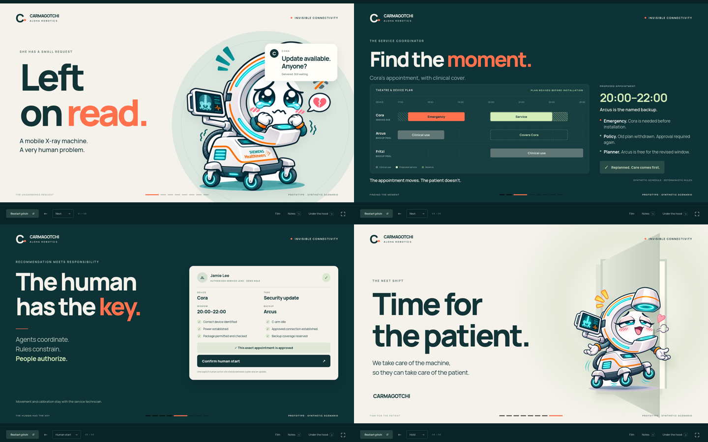

# CARMAGOTCHI — ASTRA stage edition

A three-minute coded pitch by Aloha Robotics for the Invisible Connectivity challenge. Eight scenes follow Cora from an unanswered service request through scheduling, an emergency replan, a proposed physical connection, explicit authorization, and a verified synthetic handover.

[Open the presentation](https://clschulzer.github.io/Aloha-Robotics-HH2.0/ASTRA/) · [Open with presenter notes](https://clschulzer.github.io/Aloha-Robotics-HH2.0/ASTRA/?notes) · [Read the script](research/script.md)



This edition lives entirely inside `ASTRA/`. The existing presentation, team materials, and backups remain untouched. It uses local assets and standard browser JavaScript; no build step or package installation is required.

## Launch

From the repository root:

```bash
python3 -m http.server 8765 --bind 127.0.0.1
```

Open [the pitch](http://localhost:8765/ASTRA/) or [the pitch with presenter notes](http://localhost:8765/ASTRA/?notes).

Use the HTTP server rather than opening `index.html` directly, because the app uses JavaScript modules. Click **Start pitch** to reset the synthetic scenario and begin the rehearsal clock. The opening film starts after the spoken introduction. Its final edit is a muted 5.3-second chase sting; the Cora screen provides a fallback if playback fails.

## Rehearsal controls

| Control | Action |
|---|---|
| `→`, `Space`, or `Page Down` | Advance the next intentional cue or workflow action. |
| `←` or `Page Up` | Return to the previous scene. |
| `N` | Show or hide presenter notes. |
| `Q` | Open the technical appendix; its own sandbox is separate from the pitch. |
| `F` | Toggle fullscreen. |
| `P` | Start or pause the rehearsal timer. |
| `Home` / `End` | Jump to the opening / final scene. |
| **Start pitch** / **Restart pitch** | Reset the stage workflow and start the clock. |

When a focused button owns Space or Enter, that key activates the button. Move focus back to the stage for clicker-style advancement. The appendix owns keyboard focus while open; close it to resume stage navigation.

Use one speaker and one operator. The next-cue button labels the upcoming action. Advancing can introduce an emergency, dispatch the companion, approve the appointment, confirm a human start, receive a simulated result, or confirm local checks and release. The clock never authorizes a device action. Going backward or jumping to a scene does not undo or complete the workflow; restart for a fresh run.

Keep the opening punchline and final care sentence for their intended reveals. Let the cable joke land silently. Hold the final frame after the last line.

## The 180-second story

| Scene | Start | Duration |
|---|---:|---:|
| `arrival` — meet Cora | 0:00 | 18 s |
| `handoff` — the missing handover | 0:18 | 18 s |
| `window` — find and revise the appointment | 0:36 | 33 s |
| `connect` — power and the approved data connection | 1:09 | 26 s |
| `authorize` — a person confirms the start | 1:35 | 23 s |
| `return` — result, local checks, release | 1:58 | 21 s |
| `pilot` — the next integration step | 2:19 | 18 s |
| `finale` — tomorrow’s patient | 2:37 | 23 s |
| **Total** | | **180 s** |

The [stage script](research/script.md) contains exact spoken words, timing, operator directions, and a single JSON cue block. [story.mjs](story.mjs) supplies the live presenter notes. Keep its `STORY` array aligned with the script when editing.

## What the decision engine demonstrates

[engine.mjs](engine.mjs) evaluates synthetic calendar candidates, handover allowance, contingency time, and available backup coverage. It checks simulated physical readiness, package eligibility, current evidence, authorization, and clinical-use state. Approval is bound to a specific plan. A pre-start emergency invalidates that plan; an emergency after installation starts activates continuity handling rather than pretending the installer can be safely interrupted.

A simulated return is separate from local checks and human release. After installation starts, the device remains unavailable until release. The appendix exposes fault inputs and an event trace so these decisions can be inspected.

This is a local deterministic workflow prototype. It has no connected hospital feed, medical device, robot, manufacturer service interface, identity provider, or AI model. The companion, agent coordination layer, and real device integrations are proposed work. Demonstration values are not validated clinical timings or impact measurements.

## Tests

From `ASTRA/`:

```bash
node --test tests/engine.test.mjs
```

Or from the repository root:

```bash
node --test ASTRA/tests/engine.test.mjs
```

The suite exercises the decision engine’s permitted and blocked transitions, including calendar conflicts, backup coverage, authorization, changed evidence, emergencies, and release. All 18 ASTRA tests and the 15 existing planner tests passed.

Firefox 159 also passed the complete stage workflow, keyboard controls and fault scenarios with no console errors. Desktop and narrow-viewport screenshots were visually reviewed. [The validation record](research/validation.md) includes the reproducible browser harness and remaining checks for the actual projector and live delivery. Synthetic tests do not establish hardware behavior or clinical safety.

## Public rehearsal API

[app.mjs](app.mjs) exposes a frozen `window.astra` object for explicit local rehearsal controls. It is a browser API for this demonstration; it does not connect to external systems.

| Member | Behavior |
|---|---|
| `version` | API version string. |
| `getState()` | Return a cloned snapshot with `scene`, `sceneIndex`, `elapsed`, `workflow`, and `lab`. |
| `start()` | Reset the scenario, go to the opening, start the clock, and schedule the opening film. |
| `next()` | Run the same next-cue behavior as the stage button. |
| `previous()` | Show the previous scene without reversing workflow state. |
| `goTo(id)` | Show one of the eight scene IDs; unknown IDs throw a `RangeError`. |
| `dispatch(event)` | Apply an explicit synthetic workflow event and render the result. Accepts a type string or an event object. |
| `notes(force)` | Show or hide notes with `true` / `false`; omit the argument to toggle. |
| `appendix(tab)` | Open the appendix and pause the clock; tab names are `system`, `test`, `character`, and `evidence`. Defaults to `system`. |
| `reset()` | Reset the scenario and clock, return to the opening, and leave the timer stopped. |

For example, an authorized rehearsal operator can inspect the state without changing it:

```javascript
window.astra.getState()
```

Explicit synthetic workflow event types include `PREPARE`, `ATTEST`, `START`, `EMERGENCY`, `VERIFY_SUCCESS`, `VERIFY_FAILURE`, `RELEASE`, and `SET_CONDITION`. The engine still evaluates its rules when events are dispatched; a call is not proof that the requested transition succeeded. Inspect the returned state or `getState().workflow.lastAction`.

## Files and research

- [index.html](index.html), [stage.css](stage.css), [app.mjs](app.mjs): stage, presentation behavior, presenter desk, and appendix.
- [story.mjs](story.mjs): timed speaking cues.
- [engine.mjs](engine.mjs) and [tests/engine.test.mjs](tests/engine.test.mjs): deterministic scenario rules and tests.
- [research/script.md](research/script.md): final spoken script, cues, and Q&A.
- [research/narrative.md](research/narrative.md): narrative choices, source interpretation, major cuts, and editorial review.
- [research/technical.md](research/technical.md): technical evidence and claim boundaries.
- `research/media-review/`: local contact sheets and media inspection artifacts.
- `assets/`: local character art, the opening film, and font files.

The underlying interviews remain in the repository’s `transcripts/` directory. Their observations ground the pitch; speculative architecture notes are not treated as records of working manufacturer integrations.
