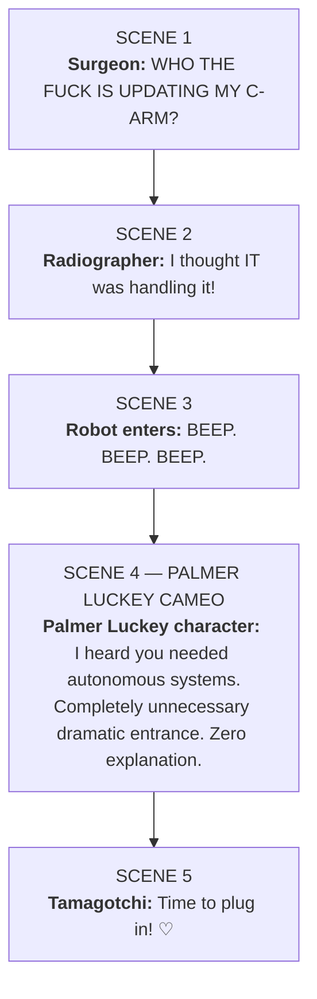
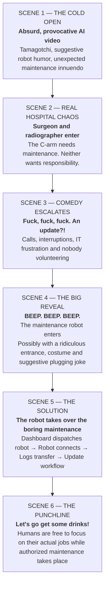
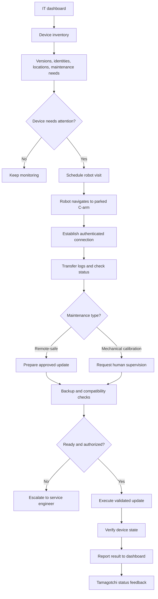
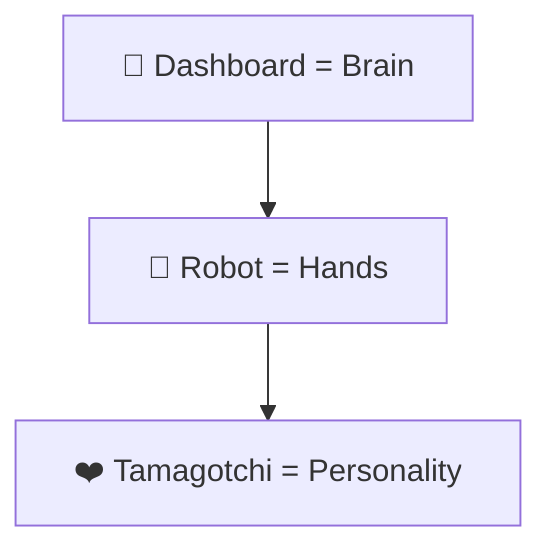

# C-ARMAGOTCHI: The Unhinged Pitch Recap 🤖

You weren't just brainstorming a robot that maintains Siemens C-arms. By the end of the five-minute conversation, you had escalated into **a completely ridiculous, slightly NSFW, theatrical hackathon pitch involving a surgeon, an overworked radiographer, an unexpectedly sexy maintenance robot, a Tamagotchi and a dramatic entrance.**

Here's the sequence reconstructed from your recording, including the jokes that got lost in my previous, much-too-professional summary.

## 1. The actual funny ideas you came up with

### ❤️ The surgeon who doesn't give a fuck

Someone dresses as a surgeon, another person plays the overwhelmed radiographer. The surgeon has no interest in IT or maintenance. The C-arm demands attention at exactly the wrong moment.

The running joke: *"Who takes care of the C-arm? I don't. Let's go get some drinks."*

### 🤖 The stupid robot gets its grand entrance

You talked about using the robot Siemens already has, apparently one with very few practical use cases so far.

Someone suggested a live demo, and then the whole thing turned theatrical:

*"Beep, beep, beep. Robot is coming!"*

People enter from opposite sides of the stage, surgeon costume and all, while the robot dramatically appears as the hero.

### 💗 The Tamagotchi becomes a horny little machine

This is where your brainstorming went off the rails.

You explicitly said that hearing the Tamagotchi idea made you immediately imagine an **AI-generated video with a sexual/comedic opening**, apparently involving a threesome.

The transcription around *"threesome of the palm"* is garbled, so I can't reconstruct the exact visual. But the idea was clearly to make the opening deliberately inappropriate and unexpected, before pivoting to the actual medical device.

The Tamagotchi's innocent lines — *"Time to work!"*, *"Time to update!"* — suddenly gain a completely different meaning.

### 🔌 The plugging / strap-on jokes

You repeatedly came back to *"plugging, plugging, plugging"* and somebody suggested attaching something to the robot with a **strap-on**.

There's an obvious double meaning: the robot is technically coming to plug into the C-arm, but you were exploring how to make that sound ridiculously sexual.

The exact proposed attachment is unclear in the recording, but the innuendo was definitely part of the brainstorming.

### 🎬 The AI video might get you banned

Someone immediately pointed out that an AI video generator might refuse to produce the sexual version.

And then came the alternative: **just perform it yourselves on stage.**

The conversation escalated to someone joking that the presentation should start with:

*"Is everyone below 18? Please leave the room."*

You also joked about doing the whole thing with complete confidence and a straight face.

---

### 🎭 BONUS — THE PALMER LUCKEY CAMEO!

HAHA YES 😭 **THE PALMER LUCKEY CAMEO!** How did I leave out arguably the funniest part?

It's literally in the recording:

> "And all of a sudden there's a fucking surgeon ... and on the other side ... you get the fucking robot."

And someone mentions **Palmer Luckey** right in the middle of planning that ridiculous entrance.

The joke practically writes itself: Palmer Luckey, the founder of Oculus and Anduril, associated with futuristic military technology, somehow appears in a Siemens hospital-maintenance pitch involving a robot, a horny Tamagotchi and someone desperately trying to plug in a C-arm.

**Even better: one of your teammates looks just like Palmer Luckey.** So the cameo can be a live lookalike gag, not a promise that the real Palmer Luckey is appearing.

#### The cameo in the pitch



**SCENE 1**

**Surgeon:** "WHO THE FUCK IS UPDATING MY C-ARM?"

**SCENE 2**

**Radiographer:** "I thought IT was handling it!"

**SCENE 3**

**Robot enters:** BEEP. BEEP. BEEP.

**SCENE 4 — PALMER LUCKEY CAMEO**

**Palmer Luckey character:** "I heard you needed autonomous systems."

*Completely unnecessary dramatic entrance. Zero explanation.*

**SCENE 5**

**Tamagotchi:** "Time to plug in! ♡"

The best part is **not explaining the Palmer Luckey cameo at all**. Just have someone dressed like him walk across the stage with complete confidence, as though this were perfectly normal.

One qualification: the recording clearly mentions Palmer Luckey, but doesn't establish exactly what he was supposed to do. The dialogue above is my comedic addition.

And now the pitch has everything: a surgeon, a horny Tamagotchi, a maintenance robot, a strap-on joke, an inexplicable Palmer Luckey appearance, and somehow a legitimate Siemens Healthineers business case.

**Practically perfect. XD**

---

## 2. The original presentation skeleton

This is how I reconstruct the intended flow of your chaotic pitch. The order of a few jokes is reconstructed, not a finalized sequence from the recording.



**SCENE 1 — THE COLD OPEN**

**Absurd, provocative AI video**

Tamagotchi, suggestive robot humor, unexpected maintenance innuendo

**SCENE 2 — REAL HOSPITAL CHAOS**

**Surgeon and radiographer enter**

The C-arm needs maintenance. Neither wants responsibility.

**SCENE 3 — COMEDY ESCALATES**

**“Fuck, fuck, fuck. An update?!”**

Calls, interruptions, IT frustration and nobody volunteering

**SCENE 4 — THE BIG REVEAL**

# BEEP. BEEP. BEEP.

**The maintenance robot enters**

Possibly with a ridiculous entrance, costume and suggestive plugging joke

**SCENE 5 — THE SOLUTION**

**The robot takes over the boring maintenance**

Dashboard dispatches robot → Robot connects → Logs transfer → Update workflow

**SCENE 6 — THE PUNCHLINE**

**“Let's go get some drinks!”**

Humans are free to focus on their actual jobs while authorized maintenance takes place

## 3. A possible three-minute stage version

This is my proposed structure using your jokes, rather than a transcript of an agreed final script.

| Time | Action | Joke / Purpose |
|---|---|---|
| 0:00–0:20 | AI-video cold open | The suggestive Tamagotchi/robot joke. Abruptly transition to the hospital. |
| 0:20–0:45 | Surgeon rushes in | "I have patients to operate on. Who's updating this fucking machine?" |
| 0:45–1:00 | Radiographer panics | Gets an IT call. Nobody wants to deal with updates. |
| 1:00–1:20 | Dramatic robot entrance | "BEEP BEEP BEEP!" Robot appears, possibly with a deliberately ridiculous connecting accessory. |
| 1:20–2:15 | Actual live demonstration | IT dashboard identifies a C-arm, dispatches robot, robot makes a simulated connection, logs synchronize. |
| 2:15–2:40 | Tamagotchi celebrates | "I'm happy! I'm updated!" The robot receives its next assignment. |
| 2:40–3:00 | Final punchline | Surgeon and radiographer leave. "Let's get drinks." Reveal product name and actual value. |

The sexual comedy works better as a short, absurd setup than as the entire pitch. You want the judges laughing *and* understanding why Siemens would buy the solution.

---

## 4. The actual technical workflow

Here's the proper system architecture behind the madness.

**Robot maintenance workflow**



*The robot's physical connection and update capabilities are proposed, not verified. Updates involving movement cannot be assumed safe without supervised calibration.*

## 5. The Tamagotchi personality workflow

You also had the seed of a genuinely interesting interaction model: make equipment act like a little companion that communicates maintenance needs.

### C-ARMAGOTCHI

**Needs connectivity**

```text
        ╭───────────────────╮
        │  ╭─────────────╮  │
        │  │   ◕   ◕     │  │
        │  │     ︵       │  │
        │  ╰─────────────╯  │
        │     ●   ●   ●     │
        ╰───────────────────╯
               ◕︵◕
```

**“I haven't been connected in a while…”**

Choose a scene to preview the character's reaction:

| Scene | Face | Status | Tamagotchi says |
|---|---|---|---|
| **Happy** | ◕‿◕ | Operational | "I'm ready! Everything is synchronized." |
| **Lonely** | ◕︵◕ | Needs connectivity | "I haven't been connected in a while…" |
| **Needy** | ಠ_ಠ | Service required | "Hey! I need an update!" |
| **Excited** | ★ᴗ★ | Robot dispatched | "Ooooh! The maintenance robot is coming!" |

*This is the static Markdown version of the original interactive mood selector; all four states and their messages are preserved.*

This could be a hilariously effective visual companion to a serious technical dashboard, provided the cartoon's happy state never falsely implies clinical readiness.

---

## 6. Other brainstorming threads worth remembering

You also discussed commercializing this as a **new Siemens Customer Services offering**, possibly charging hospitals for the robot maintenance service.

Someone mentioned approaching a Customer Services innovation director, whose name sounds like "Luca Falingham" in the transcription, and another person called Amira. You joked about asking Customer Services for more money to fund your robot idea.

There was also the observation that Siemens apparently has a robot without many established use cases. Your team might be the only people trying to find a purpose for it, which makes the whole proposal funnier.

And the important real-world objection: smaller hospitals with decentralized IT may not have the infrastructure or money to justify a roaming maintenance robot.

## 7. The overarching concept

The whole brainstorm can be reduced to three connected ideas:



**Dashboard = Brain**

**Robot = Hands**

**Tamagotchi = Personality**

And your ridiculous comedy pitch is essentially:

**A horny, attention-seeking C-arm needs servicing. The surgeon refuses. The radiographer is overwhelmed. A robot dramatically arrives, plugs it in, and saves the day.**

That was the spirit of the five-minute brainstorm. The serious idea underneath is an automated, managed maintenance service for mobile medical equipment, but the memorable part was the absurd human-versus-robot performance you imagined for the stage.
