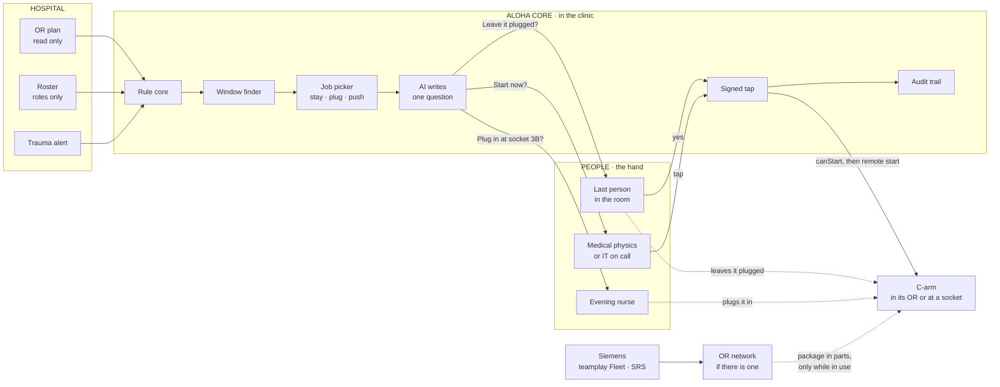
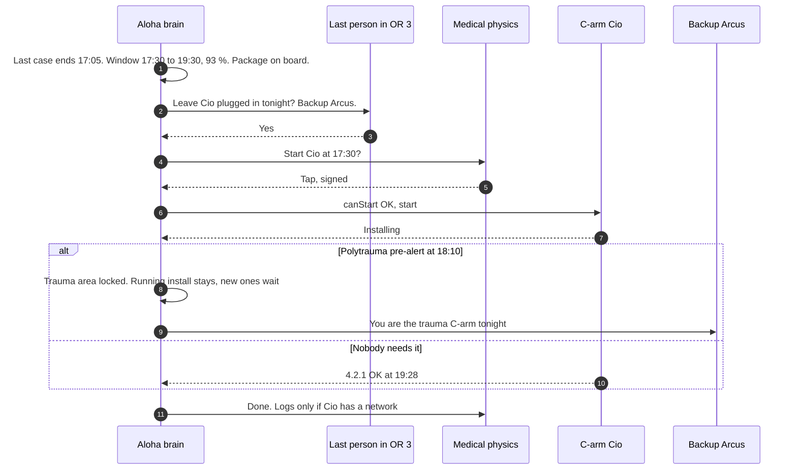

# A · People-powered: the right person at the right minute

> No hardware. The brain finds the window, then asks **one** named person **one** question at the moment they can act: "Leave Cio plugged in tonight? It updates 17:30 to 19:30, backup Arcus."

**Verdict.** This is the cheapest thing that can work, and it's the right first stage for every other option. On its own it only reaches C-arms that already have the package on board: 45 % patched by the deadline in our base case. Fix the data path and the same people reach about 91 % with no hardware at all (simulator scenario "lan").

**Best for:** a pilot in weeks, small sites, ORs with a network link. **Not for:** devices that never see a network, and nights with thin staff.

## What it looks like

17:05, OR 3. The last case of the day is closed. The OTA's phone buzzes once: *"Cio can stay plugged in tonight. Update 17:30–19:30, backup Arcus. OK to leave it where it is?"* She taps **Yes** and goes home. At 17:30 medical physics gets *"Start Cio now? Area checked by Lena 17:06"* and taps. Nobody pushed anything anywhere.

## How it works

1. **The brain** (rule core + window finder) lists every legal window per C-arm with its chance of finishing undisturbed.
2. **It picks the cheapest people job** that powers that window:
   - **A1 · stay plugged.** It stays where it is after the last case, already on and already plugged in. About 1 minute of clinic time.
   - **A2 · plug in.** Plug it into the socket next to its parking spot and switch it on. About 3.5 minutes.
   - **A3 · push.** Push it to the nearest socket. About 10 minutes, last resort.
3. **The AI writes one question** for one role at the right minute: the last person in the room, the evening nurse or the transport service. If they say no, the brain tries the next job or the next night.
4. **One signed tap** from the on-duty confirmer (medical physics until 17:00, then IT on call), then `canStart()`.
5. **The phone and a door tag** say "updating until 19:30, take Arcus". There's no guard at the device itself.

## Architecture



## A normal evening, and the night it goes wrong



If the person says **No**, nothing happens to the C-arm. The brain tries A2 or A3, or the next evening.

## What it needs

| From | What |
|---|---|
| Siemens | Nothing new: packages through teamplay Fleet, the remote start that ~99 % of security patches already allow, the status the device already reports |
| Hospital | Read-only OR plan (room, time, device need), roster by role, a messaging channel to staff phones, a written rule for who may say yes, sockets within 7 m where possible |
| Us | Brain (exists as a prototype), job picker, one-question messages, signed tap, audit trail |

## Pros

- **Zero hardware and zero new network paths.** IT security only has to approve a read-only import of the OR plan. A pilot can start in weeks.
- **It hits the root cause Siemens named:** "Nobody feels responsible" (transcript 04). One named person, one moment, one question, and it's logged who said yes.
- **A1 costs about a minute.** The C-arm is already on, already plugged in, already in a room with nobody in it.
- **It works on every C-arm in the installed base** without touching the device, so there's no MDR question.
- **It produces the map for every later investment:** which C-arms never see a network, and which park where there's no socket.

## Cons

- **People can bring power, not data.** A C-arm that never sees a network never gets the package. That caps the base case at 45 %.
- **Socketless spots mean pushing a ~300 kg C-arm.** That's the top loss in the simulator (≈3 declined pushes per round).
- **Nothing at the device guards the install.** Anyone can unplug mid-update; only the phone names the backup.
- **It depends on evening staff.** After 22:00 we assume only 60 % say yes.
- **Cables in corridors** are a trip hazard, and hospital corridors are escape routes (Christian's spec: keep 1.2 m clear).
- **It costs the most clinic time:** about 6 minutes per patched C-arm.

## Risks and what we do about them

| Risk | What we do |
|---|---|
| Alert fatigue | At most one question per person per evening, and only when a real window exists. "No" costs nothing. |
| The wrong C-arm gets moved | The device file has a photo and the parking spot, and the job card names both. |
| "Who is liable if it fails?" | The signed start belongs to medical physics or IT. The OTA only agrees not to unplug it. |
| Works council (BetrVG § 87) | The platform knows roles, not performance. No ranking, no "who said no" reports (Christian's principle "Menschen als Rollen"). |
| Unplugged mid-install | A door tag plus a phone notice to the room's next user. This is the biggest weakness, and it's why C and D add a guard at the device. |

## Effort and cost (rough)

| Item | Estimate | Status |
|---|---|---|
| Hardware | €0 | n/a |
| Integration | OR plan as an export or HL7v2 SIU, roster as a table by role | Christian's pilot cut |
| Time to pilot | 4 to 8 weeks | Assumption |
| Clinic time | ≈6 min per patched C-arm | Simulator base case |

## Fit against the challenge

| Criterion | Score |
|---|---|
| Works on today's C-arms unchanged | ●●●●● |
| Power without a socket | ●○○○○ |
| Data without OR Wi-Fi | ●●○○○ |
| Guards the install | ●●○○○ |
| Low clinic effort | ●●○○○ |
| Hospital IT acceptance | ●●●●● |
| Light regulatory load | ●●●●● |
| Time to a pilot | ●●●●● |
| Low hardware cost | ●●●●● |
| Scales to many sites | ●●●○○ |

## In the simulator

On the base case (12 C-arms, 14-day deadline, see `sim/results/RESULTS.md`), 45 % are patched by the deadline, at 6.2 clinic minutes per patched C-arm. The top loss is "nobody pushed it to a socket". **If every C-arm gets the package while in use, the result jumps to 91 % at €0, and A becomes the best buy.**

## An 8-week pilot if this were the only option

1. **Weeks 1–2:** read-only OR plan import and a device file for 4 to 6 C-arms: where each one parks, whether there's a socket, whether it gets a network link.
2. **Weeks 3–8:** live questions, one tap per start, audit trail.
3. **KPIs:** share of questions answered yes, patched by the deadline, clinic minutes per update, zero cases touched, zero unplugged mid-install.

## Questions the jury may ask

- **"Isn't this just a reminder app?"** The reminder is the last 1 %. The other 99 % is finding a window that's legal and survives the evening (rules, P(undisturbed), a backup that's free the whole time), and asking the one person who can act at that minute. Siemens told us the failure is responsibility, not technology.
- **"What if nobody says yes?"** The brain tries the next job or the next night. At the deadline it escalates to medical physics with a window that's already checked.
- **"What about nights?"** A1 happens at 17:00 to 19:30, while people are still in the house.

## Open questions for Siemens

1. Does a Cios download the package in parts while it's in use in the OR, for example over the DICOM LAN?
2. Can IT trigger the remote start through SRS or teamplay Fleet without anyone at the device, once a person has confirmed the area is clear?
3. Is "leave it plugged and on for 2.5 h after the last case" acceptable for the device (heat, standby draw, fans)?

## One-shot build prompt

Paste this into an agent at the repo root. It's meant to run in one pass.

```text
Build breif/prototypes/a-people/index.html: one self-contained page, opens from file://, no network, no build step.
Goal: option A "People-powered" working end to end on a synthetic hospital evening.
Reuse, do not modify: breif/sim/engine/planner.js, breif/sim/engine/golden.js, breif/sim/model.js (load with <script>).
Show, in this order:
1. The fleet for one weekday (BreifSim.hospital(BreifSim.PARAMS, 0).days[2]): each C-arm, its cases, socket yes/no, package on board yes/no.
2. The brain's pick per C-arm: best window from BreifSim.windowsFor(...) and the cheapest people job (stay, plug, push) from BreifSim.MODES with its chance.
3. A phone mock that receives exactly one question per person, with Yes and No. "No" moves to the next job or the next night.
4. A start screen for the on-duty confirmer. It refuses unless planner.canStart() passes, and it shows the reasons when it fails.
5. A polytrauma button that locks TRAUMA and EMERGENCY and replans unstarted windows with the same rules.
6. An audit trail: every question, answer, tap, start and result, append only.
Rules (also as console.assert tests in the page): never during a case, never without a backup, at most 2 per night, no start without a signed tap, no patient data anywhere.
Label every assumption on screen as "assumption". No questions back, no TODOs, finish in one pass.
```
