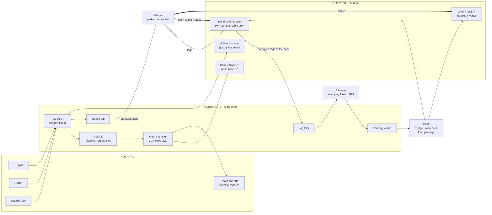
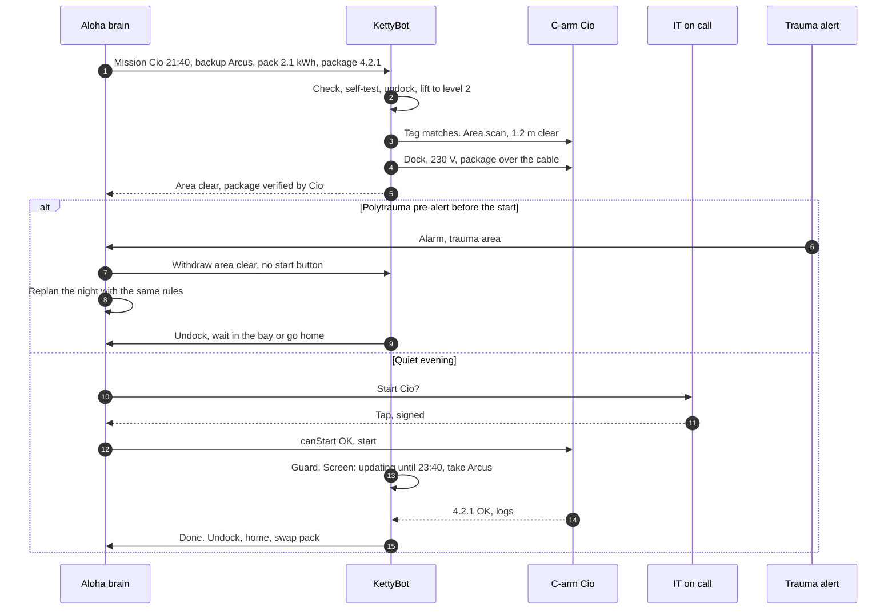

# D · Robot courier: KettyBot brings the socket

> One robot serves many C-arms. At night it drives to the parked C-arm with a battery pack and the package in its own memory. It docks, reports "area clear", waits for one human tap, guards the install, and takes the logs home.

**Verdict.** It's the best demo, and a real answer for nights and floors without sockets. The physics bite, though:

- **One install per trip.** An install needs about 2 kWh, about 20 kg of battery. KettyBot carries 30 kg spread over three trays.
- **No arm.** Either the C-arm cart gets a docking adapter, or a person plugs the cable in.
- **Doors and lifts** need integration.
- **One robot can't keep up on a big site:** 68 % patched in the simulator with 30 C-arms.

Use it as the *scale hand* inside F, not as the whole answer. That matches Christian's pitch: "a pilot, no robot needed to start".

**Best for:** big floors with many socketless spots, nights with thin staff, and the stage demo. **Not for:** being the first purchase, or large fleets with one robot.

## What it looks like

21:10. KettyBot leaves its dock in hallway A carrying a battery pack and package 4.2.1 in memory, and takes the lift to level 2. It recognises Cio by its tag and scans: nobody within 2 m, 1.2 m of escape route clear, brakes on. It docks its magnetic connector to Cio's adapter. Its 18.5" screen reads *"Updating Cio until 23:40. Need a C-arm? Arcus is in OR 4 →"*. IT on call taps start. At 23:40 it reports *"4.2.1 ✓"*, takes the logs, undocks, and goes home to swap the pack.

## How it works (Christian's 12-step mission, `spec-robot-cockpit.md`)

1. **Check the mission:** window released, package signed and not recalled, battery enough for the install plus rollback plus the way home, no alarm in the area.
2. **Self-test and undock.**
3. **Drive.** Doors and lifts go through a building gateway, with VDA 5050 as a candidate interface to the fleet manager.
4. **Recognise the device.** Wrong ID means abort.
5. **Scan the area.** LiDAR, and a camera evaluated on the robot with nothing stored.
6. **Plug in power and network.** KettyBot has no arm, so either a magnetic docking adapter on the C-arm cart (it breaks away on a pull) or, in the pilot, a person plugs the cable.
7. **Check the package and the C-arm's state.**
8. **Report "area clear" and wait for the human.** The robot never starts an update.
9. **Guard the install.** The screen shows the backup, and an "I need this C-arm" button acts like an alarm for this one device.
10. **Report and fetch logs.**
11. **Unplug and drive home.**
12. **Dock and report.**

## Architecture



The drive computer (Wi-Fi) has no access to the cable. The hand-over module (cable) has no radio. **The robot is never a bridge.**

## One mission, and the polytrauma that interrupts it



## What it needs

| From | What |
|---|---|
| Siemens | OK for a docking adapter on the cart, or a person plugging in. Release of the battery inverter as mains source (ME system, IEC 60601-1). What an update draws. Remote wake. Update hand-over on the LAN port |
| Hospital | Lift and door integration, a robot zone (Z2), a dock with charging and fire-safety sign-off, works council agreement (camera, asks to staff), corridors with 1.2 m clear |
| Us | Mission planner on the brain, cockpit, robot app (Pudu open platform), hand-over module, a pack mount within the 3 × 10 kg tray limits |

## Pros

- **One robot serves many C-arms.** Hardware scales with floors, not with devices.
- **It brings everything:** power, the package, an "area clear" report from its sensors, a guard, and the logs home.
- **It works at night without staff,** if Siemens confirms remote wake.
- **It's the demo.** You can see the physical connectivity, and it's the team's prototype in the room.
- **Its screen is the best guard:** "updating, take Arcus", with a big button for "I need it".
- **It exists today:** about US$11–20k, with lift and door integration offered by dealers.

## Cons

- **Payload.** 30 kg spread over three 10-kg trays. A 2 kWh pack (18–22 kg) needs a custom mount and covers one install per trip.
- **No arm.** Every C-arm cart needs a docking adapter (a retrofit Siemens must accept), or a person plugs in.
- **Doors, lifts and obstacles.** In the simulator, "robot mission failed" costs 1.5 windows per round at an assumed 90 % mission success.
- **Capacity.** One robot manages about 2 installs a night. On 30 C-arms with up to 6 a night, it's the bottleneck: **68 %** by the deadline.
- **Regulation.** The Machinery Regulation 2023/1230 applies from 20.01.2027 to the robot and its control. IEC 60601-1 applies to the power combination. BetrVG § 87 applies to the camera and the asks to staff. The CRA applies to the robot software (Christian's map).
- **Bridge risk.** The robot is on Wi-Fi and on a cable to the C-arm. That's the classic pattern behind bridged networks (Claroty, cited in Christian's research), so it needs the hand-over module rules.
- **Corridors at night.** Cleaning, beds, and escape routes narrowed by a robot parked for 2.5 h.
- **Cost:** ≈ €42k for one site, including lift and door integration (assumption).

## Risks and what we do about them

| Risk | What we do |
|---|---|
| The robot bridges Wi-Fi and the device network | Separate hand-over module with its own storage and a fixed message set, and no routing. The C-arm verifies the signature (Christian's Z8 rules 1–7) |
| Battery fire load | The pack charges only at the dock, with cell monitoring, parking only at approved spots |
| It gets stuck | It never unplugs mid-install (V-08), asks for help nearby, and the brain hands the window to people or the next night |
| Wrong device | ID check at step 4, abort otherwise |
| Someone pulls the cable | The magnetic connector breaks away, the cockpit reports failure, and the backup is already named |
| Staff acceptance | No images stored, works council early, the robot only in corridors in the pilot (Christian's V-13) |

## Effort and cost (rough)

| Item | Estimate | Status |
|---|---|---|
| KettyBot Pro | US$11k–20k purchase, ~US$400–480 a month as a service | Dealer listings, 2026 |
| Pack, inverter, docking adapter, dock | ≈ €6k | Assumption |
| Doors and lifts, per building | ≈ €20k | Assumption |
| One site | ≈ €42k | Assumption |

## Fit against the challenge

| Criterion | Score |
|---|---|
| Works on today's C-arms unchanged | ●●●○○ |
| Power without a socket | ●●●●○ |
| Data without OR Wi-Fi | ●●●●● |
| Guards the install | ●●●●● |
| Low clinic effort | ●●●●○ |
| Hospital IT acceptance | ●●○○○ |
| Light regulatory load | ●●○○○ |
| Time to a pilot | ●●●○○ |
| Low hardware cost | ●●●○○ |
| Scales to many sites | ●●●○○ |

## In the simulator

On the base case, 92 % are patched by the deadline, with a median of 8 days to 90 %, 3.2 clinic minutes per patched C-arm and 14.8 robot missions per round. **With remote wake it's 1.1 minutes and 6 days. With thin evening staff, the robot is the best buy (90 %).** On a 30-C-arm site with up to 6 installs a night, one robot reaches **68 %**.

## An 8-week pilot if this were the only option

This is Christian's ask #2, "a C-arm to test (training centre, with KettyBot)". One corridor (V-13), start stage S1 (a human starts at the device or through SRS), 4 to 6 C-arms. KPIs: mission success, clinic minutes, zero corridor incidents, zero unplugged mid-install.

## Questions the jury may ask

- **"Why a robot to plug in a cable?"** A calendar can't plug in a machine, the hallway has no socket, and unplugging mid-update is a known cause of dead-on-arrival devices. The robot does the last metre *and* guards the two hours. No robot? The companion does the same job without wheels, and the brain works without either.
- **"Isn't the robot a network bridge?"** No. The package comes from its own memory, goes over a point-to-point cable to exactly one device through a separate module, and is never routed. The C-arm verifies the Siemens signature.
- **"What if it's stuck in the lift?"** It fails safe. It never unplugs during an install, it asks for help, and the brain gives the window to a person or to the next night.

## Open questions for Siemens

1. Would you accept a breakaway docking adapter on the cart for power and LAN?
2. Can the C-arm power on without a person: when mains returns, by Wake-on-LAN, or by an SRS command?
3. What does an update draw, and what's the minimum set of subsystems that must be powered?

## One-shot build prompt

```text
Build breif/prototypes/d-robot/: mission.js (Node, no dependencies), mission.test.cjs, index.html (file://, no network).
Goal: option D as Christian's 12-step mission (team-material-christian/challenge-4/entwicklung/spec-robot-cockpit.md)
driven by the brain.
mission.js: the 12 states and the guard rules V-03, V-06, V-08, V-11 from the spec, with a pack model
(2.1 kWh, 713 W draw, refuse a mission below install + rollback + way home), a capacity check (one robot,
travel 10 min, swap 30 min), and the hand contract quote/deliver/guard/release from breif/00-reference-architecture.md.
The robot can never call start. It can only report areaClear. Start goes through planner.canStart() and a signed tap.
index.html: a corridor map (SVG) with the robot, the lift, three C-arms and the dock; the robot screen mock
("updating until 23:40, take Arcus"); a cockpit with remote stop (not an emergency stop); a polytrauma button that withdraws
area clear and replans with BreifSim.windowsFor on breif/sim/model.js.
Reuse, do not modify: breif/sim/engine/planner.js, breif/sim/engine/golden.js, breif/sim/model.js.
Tests: no unplug while installing, no start without a fresh area-clear message, wrong device aborts, no mission when the pack is short,
no frame forwarded between Wi-Fi and cable. No questions back, no TODOs, one pass.
```
