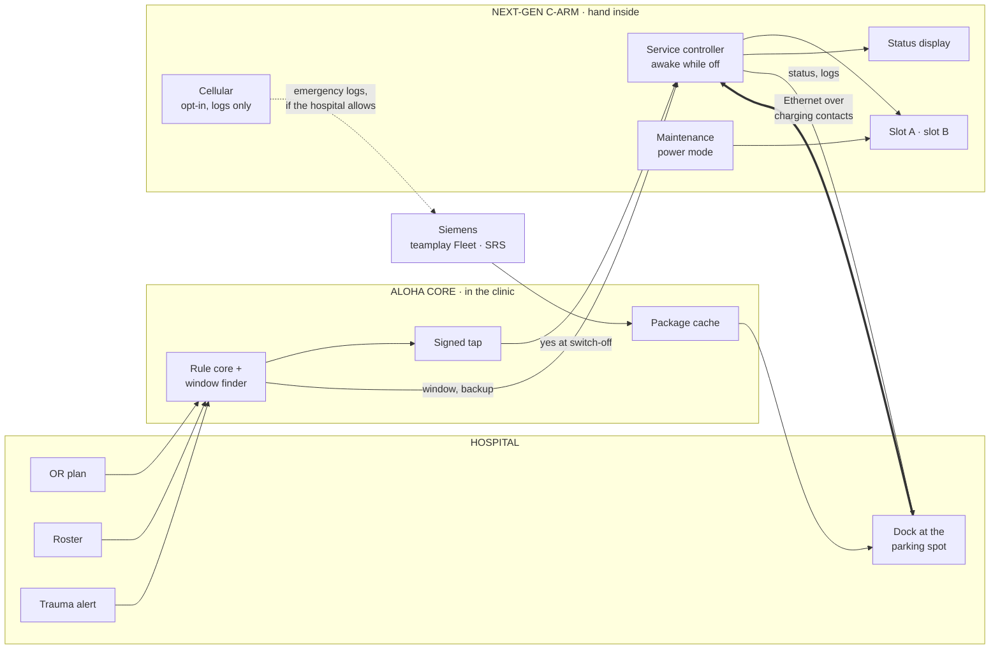
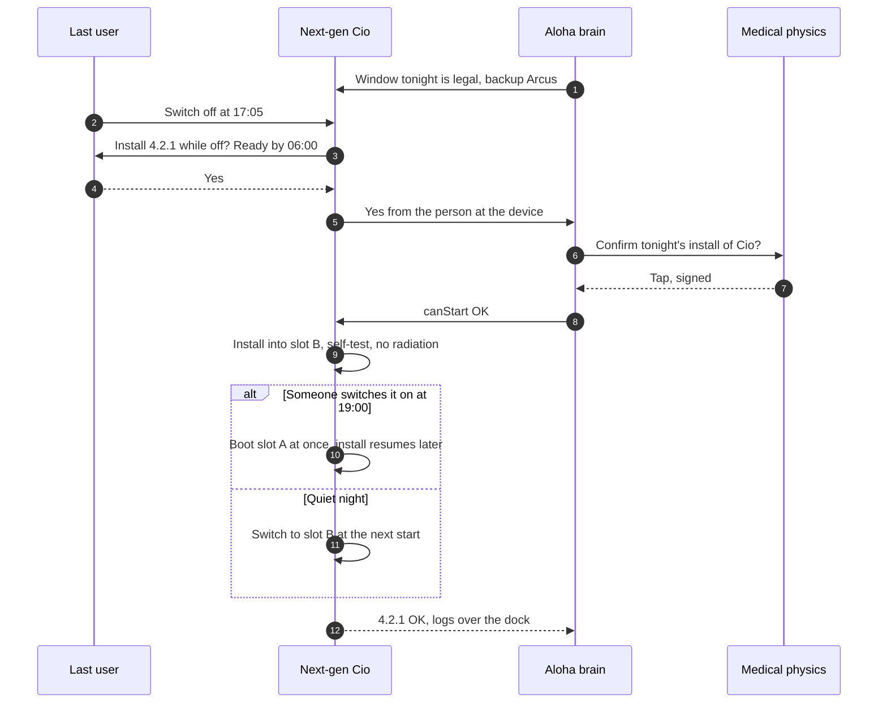

# E · Built-in: Siemens puts it inside the next C-arm

> The next generation of C-arm carries its own hand: a small service controller that stays awake while the C-arm is off, a maintenance power mode, A/B software slots, a dock with Ethernet over the charging contacts, and a status display on the outside.

**Verdict.** This is the right end state, and the wrong answer for this challenge. It only helps C-arms that haven't been built yet: with 10 % of the fleet next gen, the simulator patches 12 % by the deadline. Mobile C-arms stay in service for many years, so most of the fleet will be legacy for a long time. Legacy devices also can't take significant changes (Art. 120 MDR, MDCG 2020-3), and hospital IT may veto a built-in cellular modem (team research: rejected as a standard). Position it as **Siemens' roadmap**, which our brain plans just like every other hand.

**Best for:** Siemens' next product generation. **Not for:** the installed base, or anything this year.

## What it looks like

17:05. The OTA switches Cio off. The screen asks: *"Install 4.2.1 while off? Ready by 06:00 · backup Arcus."* She taps yes, unplugs it and parks it. The service controller installs into the inactive slot in a maintenance power mode and self-tests without radiation. Anyone who switches it on mid-way gets the old version straight away. In the morning the e-ink label reads *"4.2.1 ✓"*.

## What's built in

| Part | Job | Origin |
|---|---|---|
| Service controller | Stays awake while the C-arm is off, holds a clock for TLS, talks to the dock and to the brain | Christian's research idea J |
| Maintenance power mode | Runs only the workstation and the subsystems being flashed, from an internal pack | Proposal. Draw unknown, ask Siemens |
| A/B slots | Install into the inactive slot, switch at boot, roll back instantly | Siddhant's VHDX idea (unverified) and Christian's idea C, "Gute Nacht, C-Bogen" |
| Dock | Ethernet over the charging contacts at the parking spot | Christian's idea J, "Parken = Laden = Verbinden" |
| Status display | "Ready", "update tonight", "updating, take Arcus" | Christian's idea J |
| Cellular (optional) | Opt-in for emergency logs only, never the standard path | Christian's research: a modem bypasses the perimeter from IT's view |

## Architecture



## Switch off, install, morning



The brain doesn't go away. The hospital, as the operator, decides when to install (IEC 80001-1, MPBetreibV). Updates that touch the image chain may need a constancy test before the next patient (§ 115 (4) StrlSchV, Christian's research), so they can't run unnoticed.

## Pros

- **The cleanest experience.** Nothing extra in the corridor, and about 0.5 clinic minutes per update in the simulator.
- **One owner, one regulatory file.** Siemens controls the device, the hand and the certification.
- **A/B plus install-while-off takes the 2-hour window out of the critical path:** always ready when switched on.
- **It scales with the product line worldwide.**

## Cons

- **The installed base gets nothing.** Legacy devices take no significant changes, so this arrives with new sales, over many years.
- **Years of R&D and certification.** Siemens has been working on this problem for about two decades.
- **A cellular modem looks like a hole in the perimeter** to hospital IT. At most it's opt-in for logs.
- **A bigger internal battery** adds weight, cost and fire load inside the device.
- **It still needs the brain:** someone has to decide when, and someone has to say yes. On its own it doesn't fix "nobody feels responsible".

## Risks and what we do about them

| Risk | What we do |
|---|---|
| The ISB blocks the modem | Dock and LAN as the standard path, cellular only as an opt-in for emergency logs |
| An install-while-off update touches the image chain | Updates get a class: green ones install while off, yellow ones need a constancy test in the same window, red ones need a technician on site |
| The fleet is mixed for a decade | The hand contract: the brain plans next-gen C-arms and legacy C-arms side by side |

## Effort and cost (rough)

For the hospital, it's part of the device price. For Siemens, it's a product generation of R&D and certification, which is outside what a hackathon can estimate honestly.

## Fit against the challenge

| Criterion | Score |
|---|---|
| Works on today's C-arms unchanged | ●○○○○ |
| Power without a socket | ●●●●● |
| Data without OR Wi-Fi | ●●●○○ |
| Guards the install | ●●●●○ |
| Low clinic effort | ●●●●● |
| Hospital IT acceptance | ●●○○○ |
| Light regulatory load | ●●●○○ |
| Time to a pilot | ●○○○○ |
| Low hardware cost | ●●●●○ |
| Scales to many sites | ●●●●● |

## In the simulator

With 10 % of the fleet next gen, 12 % are patched by the deadline, because the legacy C-arms behave like today. **With a whole next-gen fleet and the modem accepted, it reaches 92 % at 0.5 clinic minutes per patched C-arm and 6 days to 90 %: the best of all options, ten years from now.**

## Questions the jury may ask

- **"Why not just build it in?"** Siemens has tried for two decades, it takes a product generation, and the installed base needs an answer now. The brain is the bridge: it plans the old fleet today and the new fleet tomorrow.
- **"Would the robot become pointless?"** For next-gen C-arms, yes. That's what the hand contract is for. Nothing else changes.

## Open questions for Siemens

1. Is A/B or install-while-off on the roadmap, and what would it take for the current Cios platform?
2. What's the smallest maintenance power mode that can complete an update?
3. Would a docking standard (power plus Ethernet over contacts) fit the next cart design?

## One-shot build prompt

```text
Build breif/prototypes/e-built-in/index.html: one self-contained page, file://, no network.
Goal: option E as a UX and state-machine prototype of a next-gen service controller.
Show:
1. The switch-off screen: "Install 4.2.1 while off? Ready by 06:00 · backup Arcus", with Yes and Not tonight.
2. A slot A / slot B view: install into the inactive slot, a self-test without radiation, a switch at the next boot.
3. "Someone switches it on at 19:00" boots slot A instantly and resumes the install later.
4. Update classes: green installs while off, yellow needs a constancy test in the same window, red needs a technician on site.
   The page refuses to install yellow or red while off.
5. A fleet view mixing next-gen and legacy C-arms, planned by the same brain (breif/sim/model.js windowsFor),
   with legacy C-arms marked "needs a hand: people, bay, companion or robot".
Reuse, do not modify: breif/sim/engine/planner.js (canStart), breif/sim/model.js.
Rules as console.assert tests: no install without a signed yes, never a yellow or red update while off, switch-on mid-install always boots the old slot.
No questions back, no TODOs, one pass.
```
