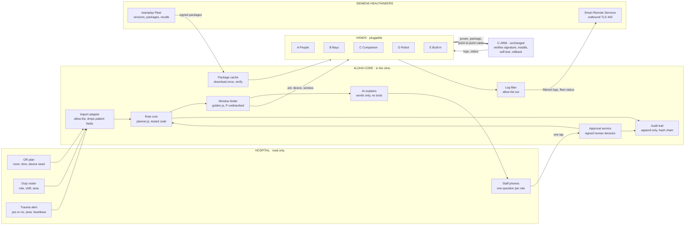
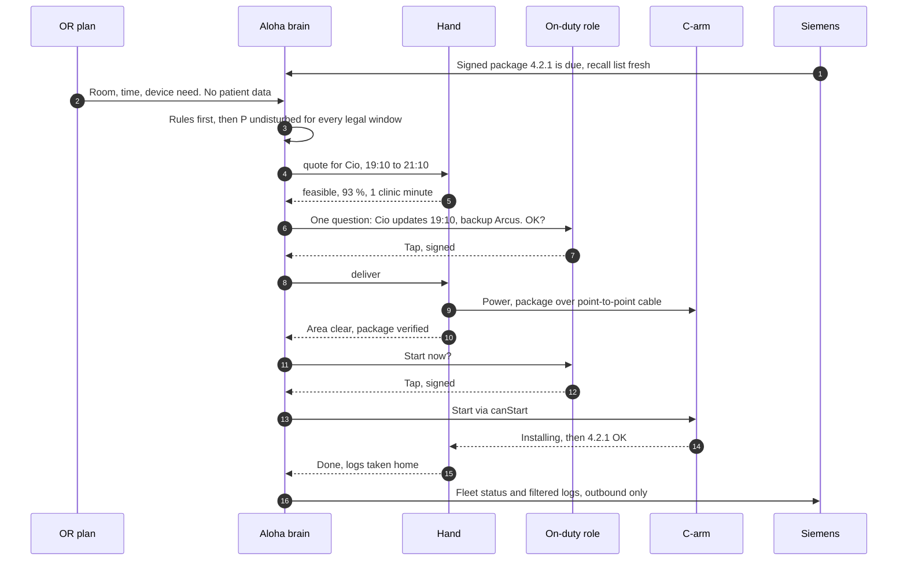

# 00 · Reference architecture: what every option shares

Every option in this folder (A to F) is built from the same blocks. They differ in one place only: **the hand**, meaning how power, the package, the switch-on and guarding reach a parked C-arm. This page defines the blocks once, so each option brief can focus on its hand.

The baseline is Christian's architecture line from his pitch demo (scene 14 in commit `2a2b60d`). He took that slide out of the 3-minute pitch in `14ae577`, so this brief is now where the architecture lives for Q&A. The other sources are his [security architecture](../team-material-christian/challenge-4/entwicklung/architektur-klinik-it-security.md) and the [team rule core](../team-material-christian/challenge-4/klickdummy/planner.js). Where this page adds something, it says so.

## The problem as four things that must line up

An update needs all four at the same time, for about 120 minutes plus a 30-minute rollback buffer:

| | What it means | Why it fails today | Source |
|---|---|---|---|
| **Power** | 230 V at the device for 2.5 h | Parked in a hallway, switched off, often no socket. The internal UPS only covers a safe shutdown. | Siemens interview, transcript 04 |
| **Data** | The full, checked package on board | Downloads happen in parts and only while the system is on and connected. Uniklinikum Erlangen has no Wi-Fi in its ORs. | transcript 04 |
| **Time** | 2.5 undisturbed hours with no case and no emergency | From plug-in to incision there is at most ~1 h, and no background work is allowed during surgery. | transcript 04 |
| **A "yes"** | One human presses start at the right moment | Not allowed to start automatically. Three roles could press it, and none feels responsible. | transcript 04 |

**The brain** solves time and the yes for every option. **The hand** solves power and data. That's why the options differ only in the hand.

## Building blocks



| Block | Job | Hard limit | From |
|---|---|---|---|
| Import adapter | The only way clinic data comes in. Reads room, time and device need from the OR plan, and role, shift and area from the roster. | Allow-list of fields. Patient fields are dropped on import. | Christian, security architecture §3 |
| Rule core | Decides what is *allowed*: never during a case, buffers, at most 2 per night, a backup device, `canStart()`. | Deterministic, versioned, 15 tests. Nothing can overrule it. | `planner.js` |
| Window finder | Decides what is *best*: the legal window with the highest chance of finishing undisturbed, with a confirmer on duty. | Can't relax a rule from the core. | `golden.js` (OPUS v2) |
| AI explains | Writes the one question for the one role ("Can Cio stay plugged in tonight? Done by 21:10."), and translates replies. | Reads only the core's JSON. No tools, no patient data. If it's down, fixed templates take over. | Christian, "Regeln sind Code, die KI ist Vorschlag" |
| Approval service | Turns a tap into a signed decision tied to device, package and plan version. | Hardware key. Neither the AI nor a hijacked node can create one. | Christian, security architecture §5.3 |
| Audit trail | Every proposal, tap, start and result. This is the evidence for medical physics, IT security and MPBetreibV. | Append only, hash chain, no patient data. | Christian, ROC-N-11 |
| Package cache | Downloads each package once, in parts, with checksums, and serves it to every hand. | It doesn't need to be trusted. The C-arm verifies the Siemens signature. Recall metadata expires, and nothing starts without fresh metadata. | Christian, security architecture §4.2 |
| Log filter | Lets only allow-listed technical fields leave the house. | Allow-list, not "anonymise later". | Christian, research synthesis |
| Hands | Bring power and the package to the device, report "area clear", guard the install, take logs home. | Transport only. Never a network bridge. Never press start. | This folder |
| C-arm | Unchanged. Verifies, installs, self-tests, rolls back. | Legacy devices get no significant changes (Art. 120 MDR, MDCG 2020-3). | Christian, research synthesis |

## The hand contract

All five hands plug into the brain through the same four calls. That's what makes option F possible, and it's also the cleanest thing to show an engineer.

```text
quote(device, window)   -> { feasible, chance, clinicMinutes, guards, needsPerson, reason }
deliver(device, window) -> { power: on, package: sha256 + signature ok, areaClear: true|false }
guard(device)           -> stream: installing 34 % | needed! | done v4.2.1 | failed
release(device)         -> { logs: encrypted for the log filter, state: parked }
```

- The brain calls `quote()` for every hand and every legal window, then picks the best chance per clinic minute. In the simulator this is one line: `score = P(undisturbed) × P(hand delivers) − 0.004 × clinic minutes`.
- No hand can call `start`. Start is a separate signed human decision through the approval service, then `canStart()`. That holds even when Siemens triggers the start remotely through SRS (≈99 % of security patches are remote-capable, transcript 04).
- `deliver()` never routes. The package goes from the hand's own storage to exactly one C-arm over a point-to-point cable with a fixed message set (offer package, read status, hand over start, fetch logs). This is Christian's rule Z8, security architecture §4.1.

## A normal evening, the same for every hand



On a polytrauma pre-alert, the brain locks the trauma area, cancels windows that haven't started in that area, and replans the rest of the night with the same rules. In the demo this takes about 2 ms. A running install is guarded: the hand or display at the device says "updating until 21:10, take Arcus".

## Guardrails that hold in every option

1. **No patient data**, ever read or sent. The OR plan gives room, time and device need only.
2. **The OR plan is read only.** The only thing written back is a calendar entry for the window.
3. **Never during a planned case, never without a buffer, never without a backup C-arm, never more than 2 per night** (rule core).
4. **A human starts every update.** One tap, a signed decision, bound to device, package and plan version.
5. **Signed packages, verified by the C-arm.** Cache, robot and companion are only transport.
6. **No hand is ever a network bridge.** Point-to-point cable, own storage, no routing.
7. **Logs leave through an allow-list**, outbound only, in the same pattern as SRS.
8. **If Aloha is down, the clinic works as today.** Missing OR data counts as "busy", and a missing alarm heartbeat counts as an alarm (Christian, security architecture §8).

## The physics budget (this decides options C and D)

| Quantity | Value | Source and status |
|---|---|---|
| C-arm mains | Regular Schuko plug, 230 V | Siemens, transcript 04 |
| Power cable length | 7 m | Cios Select data sheet (copy on Scribd), *verify for Cios Alpha/Spin* |
| Standby draw at 230 V | **713 W** | Cios Select data sheet, *ask Siemens what an update actually draws* |
| Maximum draw | 4.6 kW | Cios Select data sheet. X-ray is inhibited during service, so this is never needed |
| Network on the device | Gigabit LAN, USB 2.0 | Cios Select data sheet; WLAN/LAN/USB per transcript 04 |
| Install time | ~120 min, "fairly average" | Siemens, transcript 04 |
| Energy per install on battery | 713 W × 2.5 h ≈ **1.8 kWh**, ≈ 2.1 kWh from the pack at 85 % inverter efficiency | Our arithmetic |
| Weight of 2 kWh LiFePO4 | ≈ 18 to 22 kg | 2026 consumer power stations: Jackery 2000 v2 17.9 kg, Oupes Mega 2 22 kg |
| Medical-grade cart batteries | ≈ US$2,100 for 245 Wh, IEC 60601-1 listed | Ergotron LiFeKinnex, CDW listing |
| KettyBot payload | 3 trays × 10 kg (30 kg), 38 kg robot, 18.5" screen, lift and door integration available, ~9 h battery | RobotLAB and Pudu dealer listings, 2026 |
| KettyBot price | US$11k to 20k purchase, ~US$400–480 a month as a service | Dealer listings, 2026 |
| Package size | "Ten gigabytes, I am making up a number" | Siemens, transcript 04. Over gigabit LAN that's about 2 minutes |

**What this means:**

- A battery that runs one full install weighs about as much as KettyBot's whole payload. One robot trip means one install, and a battery companion is a cart, not a box.
- If Siemens has a service mode that powers only the workstation and the subsystems being flashed (Siddhant's 150 to 450 W, unverified), the battery drops to ~0.5 to 1 kWh and everything gets easier.
- If the install shrinks to about 30 minutes (A/B slots, Siddhant's proposal, unverified), it needs ~0.4 kWh. Then a person leaving the C-arm plugged in after the last case covers almost every device (see the simulator scenario "short").

**This is the most important question for Siemens: "What does a Cios draw during an update, and can it update with only the workstation and the flashed subsystems powered?"**

## Levers outside the hand

| Lever | Owner | Effect | Status |
|---|---|---|---|
| Find the window | Us (brain) | Turns "fire and pray" into a planned 2.5 h with a backup | Built: `planner.js`, `golden.js` |
| Get the yes | Us (one tap) | One named role, one moment, one signed tap | Built in the click dummy and demo |
| Shrink the job | Siemens | A/B slots, delta packages, install on shutdown ("Gute Nacht, C-Bogen"). Shorter windows mean more windows and smaller batteries | Proposal (Siddhant, Christian's research idea C). Ask Siemens |
| Remote wake | Siemens | The C-arm powers on when mains returns or by Wake-on-LAN, so a hand needs no person on site | Unknown. Ask Siemens. In the simulator, "nobody to switch it on" is the top reason bays, companions and robots lose windows |
| Logs first | Us + Siemens | Logs are MB and fit every visit, while updates are GB. Pre-checks before a technician visit save on-site time | Christian's research finding #1 |

## Network zones (short form of Christian's IEC 62443 view)

| Zone | Contains | Talks to |
|---|---|---|
| Z1 Medical devices | C-arms at their parking spots | Only their hand, over a point-to-point cable |
| Z2 Hands | Robot, chargers, companions, bay controllers | Z3 over mTLS, never Z1 except by cable |
| Z3 Aloha core | Node (VM or appliance), cache, audit trail, keys | Z4 read only, Z6 outbound |
| Z4 Clinic servers | OR plan, roster, alarm server, IdP, NTP | Z3 (read) |
| Z6 DMZ | Proxy, remote-service gateway | Siemens, outbound TLS 443 only |
| Z9 Building | Doors, lifts (robot only) | Z2 through a gateway |

## Sources

- Siemens interview and kick-off: [merged challenge interview](../transcripts/04_invisible_connectivity_challenge_interview_merged.md), [hospital workflows and remote support](../transcripts/02_hospital_workflows_updates_and_remote_support.md). Facts table: [archived OPUS recap](../../Archive/OPUS/RECAP.md).
- Christian: [architecture sketch](../team-material-christian/challenge-4/architektur-skizze.md), [clinic IT/security architecture](../team-material-christian/challenge-4/entwicklung/architektur-klinik-it-security.md), [robot cockpit specification](../team-material-christian/challenge-4/entwicklung/spec-robot-cockpit.md), [research synthesis](../team-material-christian/challenge-4/research/00-synthese.md), and [archived pitch demo source](../../Archive/CARMAGOTCHI_Web_Pitch/pitch-demo-christian/demo.js) (architecture slide in `2a2b60d`, call to action in `14ae577`).
- Siddhant: [autonomous C-arm fleet architecture proposal](../architecture/autonomous_c_arm_fleet_architecture.md) (VHDX A/B, docking, power table; unverified claims are marked as such here).
- Cios Select data sheet (power requirements, 713 W standby, 7 m cable, Gigabit LAN): https://www.scribd.com/document/513841827/AT-Cios-Select-Datasheet
- KettyBot specs and prices: https://www.robotlab.com/store/kettybot-pro/ and https://www.generationrobots.com/en/404251-pudu-kettybot-home-robot.html
- 2 kWh LiFePO4 weights and prices: https://www.jackery.com/products/jackery-explorer-2000-v2-portable-power-station and https://www.inkl.com/news/oupes-mega-2-review
- Medical-grade cart battery price: https://cdw.ca/product/ergotron-lifekinnex-battery/5481206
