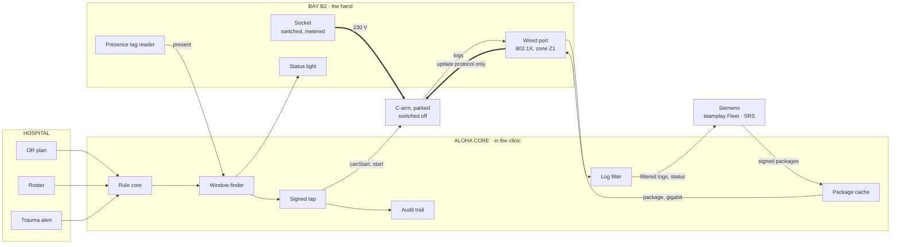
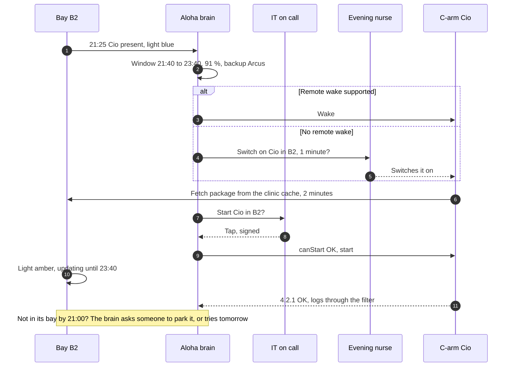

# B · Smart parking bays: parking is plugging in

> Marked parking bays in the corridors, each with a socket, a wired port on the medical-device network, a presence sensor and a status light. When the C-arm is parked, it's on power and on the network.

**Verdict.** This is the most reliable hand per C-arm, as long as the C-arm really parks there. It's building work: an electrician, a data outlet and a network segment per bay, plus fire-safety sign-off in a corridor. That's months, not weeks. Use it in renovations and new builds, and at a site's busiest parking spots. It's also the obvious Next Gen standard (Christian's research idea J: "Parken = Laden = Verbinden").

**Best for:** new buildings, sites with fixed parking spots, sites with no sockets anywhere (it brings the socket). **Not for:** a pilot this year, sites where C-arms park wherever there's room.

## What it looks like

Hallway B, 21:25. Cio rolls into bay B2. The light turns blue: *"present, package complete"*. The C-arm is switched off. At 21:40 IT on call gets *"Start Cio in bay B2? Backup Arcus."* and taps. If Siemens supports remote wake, nobody walks anywhere. If not, the evening nurse passing by gets *"Switch on Cio in B2, 1 minute"*. The bay light shows amber "updating until 23:40" so nobody takes it.

## How it works

1. **Every bay has** a switched and metered 230 V socket, a wired port that only reaches the Aloha core (medical-device zone Z1, update protocol only), a presence sensor (a tag on the C-arm, read at the bay) and a status light.
2. **Parking habit.** Staff park the C-arm in its bay, like a phone on its charger. If a C-arm isn't in its bay by evening, the brain asks: "Cio isn't in B2. Can you park it there?"
3. **The brain** plans the window only for C-arms whose bay reports "present".
4. **Package.** Gigabit LAN from the clinic cache takes about 2 minutes for 10 GB, at the start of the window or during any earlier switch-on.
5. **Switch-on.** Remote wake if the C-arm supports it, otherwise one person.
6. **One signed tap**, then `canStart()`, then the bay light guards the install.
7. **Logs** go over the bay port, through the log filter, outbound only.

## Architecture



## A normal night, and the night it's parked elsewhere



## What it needs

| From | What |
|---|---|
| Siemens | OK to connect the C-arm to a medical-VLAN port at a bay. Remote wake (Wake-on-LAN, or power-on when mains returns). The update fetching from a local mirror (our cache) rather than straight from SRS |
| Hospital | Electrician and data outlets per bay, network segment and 802.1X, fire-safety sign-off for bays in corridors, a parking rule |
| Us | Bay controller (presence, light), its link to the brain, the cache acting as a local mirror |

## Pros

- **Power and data where the C-arm already rests.** No battery, no robot, nothing to charge.
- **Lowest clinic time once installed:** 2.8 minutes per patched C-arm, and 0.7 with remote wake (simulator).
- **The easiest thing to explain to IT security:** one known port per bay, one segment, no radio, no new device on the C-arm.
- **The bay light guards the install,** so nobody takes a C-arm that's mid-update.
- **It could become a Siemens standard** for the next generation (dock, Ethernet, status), while the brain stays the same.

## Cons

- **It's building work.** Power, data, network configuration and signage per bay, and corridors are escape routes. Months of lead time and a facilities budget line.
- **It only works where the C-arm actually parks.** "Not parked in its bay" is the top loss in the simulator (4.3 per round).
- **Without remote wake, a person still has to switch it on** (1.9 lost windows per round).
- **It's fixed.** When workflows or wings change, the bays are in the wrong place.
- **A network port in a public corridor** is a physical way into a medical network. It needs port security bound to the C-arm's identity.
- **Cost scales with parking spots, not with use.**

## Risks and what we do about them

| Risk | What we do |
|---|---|
| Someone plugs a laptop into the bay port | 802.1X with the C-arm's certificate; the port only reaches the core's update service |
| The wrong C-arm is in the bay | The tag is checked against the device file; the brain only plans for the right ID |
| Parking discipline erodes | Status light, the Tamagotchi nudge, one question per evening ("Cio isn't in B2") |
| Bays get used as storage | Marked floor, the presence sensor reports "blocked" |
| Corridor fire rules | Bays only in alcoves or side rooms with 1.2 m clear. No batteries involved |

## Effort and cost (rough)

| Item | Estimate | Status |
|---|---|---|
| Per bay (socket, data outlet, signage, light, sensor) | ≈ €2,500 | Assumption, needs a facilities quote |
| 12 C-arms | ≈ €30k | Assumption |
| Time to first bays | 3 to 6 months | Assumption (facilities and IT approval) |
| Clinic time | 2.8 min per patched C-arm, 0.7 with remote wake | Simulator |

## Fit against the challenge

| Criterion | Score |
|---|---|
| Works on today's C-arms unchanged | ●●●●○ |
| Power without a socket | ●●●●○ |
| Data without OR Wi-Fi | ●●●●● |
| Guards the install | ●●●○○ |
| Low clinic effort | ●●●●○ |
| Hospital IT acceptance | ●●●○○ |
| Light regulatory load | ●●●●○ |
| Time to a pilot | ●●○○○ |
| Low hardware cost | ●●●○○ |
| Scales to many sites | ●●○○○ |

## In the simulator

On the base case, 91 % are patched by the deadline, the median to 90 % is 9 days, and it costs 2.8 clinic minutes per patched C-arm. **With no sockets near any parking spot, bays become the best buy**, because they're the only option that brings a socket without a battery.

## An 8-week pilot if this were the only option

Two or three bays in one corridor, the brain, and a parking rule for 4 to 6 C-arms. KPIs: share of nights the C-arm is in its bay, patched by the deadline, clinic minutes per update. Plan the facilities work before the 8 weeks start.

## Questions the jury may ask

- **"Why not just add sockets in the hallway?"** That's a bay without the network and without presence. Without the network the package isn't on board, so it's option A again.
- **"Fire safety?"** No batteries, alcoves only, 1.2 m kept clear.
- **"IT security?"** One port, one identity, one segment, outbound only through the DMZ. It's the same pattern as SRS.

## Open questions for Siemens

1. Does the C-arm support Wake-on-LAN, or power-on when mains returns?
2. Can it fetch the package from a local mirror on the clinic network instead of from SRS directly?
3. Would Siemens specify a standard bay (connector, light, tag) for the next generation?

## One-shot build prompt

```text
Build Documentation/architecture-options/prototypes/b-bays/index.html: one self-contained page, file://, no network, no build step.
Goal: option B "Smart parking bays" for one synthetic evening.
Reuse, do not modify: Documentation/architecture-options/sim/engine/planner.js, Documentation/architecture-options/sim/engine/golden.js, Documentation/architecture-options/sim/model.js.
Show:
1. A corridor plan with 6 bays (SVG). Each bay shows socket, port, presence and light state.
2. C-arms rolling into bays over the evening. Draw presence from BreifSim.PARAMS.bayDiscipline with a seeded RNG. One C-arm is parked outside its bay, and the brain asks a person to move it.
3. The brain's windows (BreifSim.windowsFor) for C-arms that are present. The light goes blue (ready), amber (updating) or green (done).
4. A "remote wake" toggle. Off means a person must switch the C-arm on; on means nobody walks.
5. A start screen that only enables after planner.canStart() passes.
6. An intruder test: plugging an unknown device into a bay port is refused, and the refusal shows in the audit trail.
Rules as console.assert tests: never during a case, a backup always free, at most 2 per night, no start without a signed tap.
Label assumptions on screen. No questions back, no TODOs, one pass.
```
