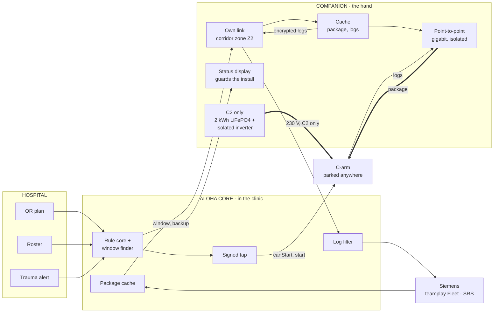
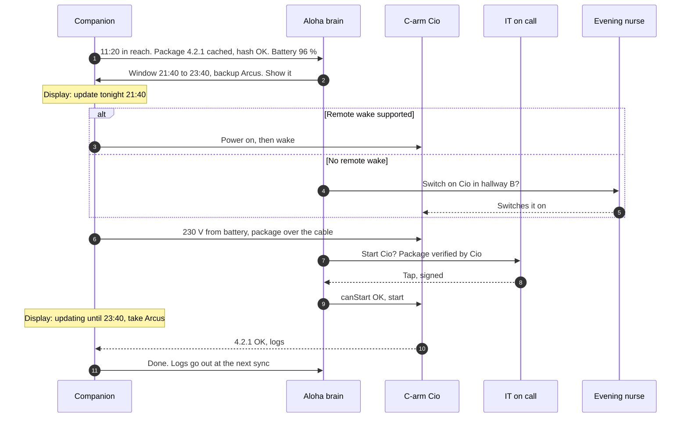

# C · Companion: a memory and a power bank that ride with the C-arm

> A box that lives with each C-arm. **C1, the data companion**, has a cache, its own small battery, a cable link to the C-arm and a status display. **C2, the power companion**, is C1 plus a battery big enough to run a full install without a socket.

**Verdict.** This was Siemens' own favourite idea ("an autonomous device alongside the main system… I would like to show that it can work"), and they're half right. **C1 fixes the cheap half on every C-arm.** That's the data, the logs and a display that guards the install, for roughly €600 each (assumption). **C2 also fixes power,** but one full install needs about 2 kWh, which is about 20 kg per C-arm, and a power combination Siemens has to release under IEC 60601-1. Our pick: C1 on every C-arm as part of F, and C2 only for the few C-arms that live far from any socket.

**Best for:** data and logs everywhere (C1), lone C-arms far from sockets (C2). **Not for:** buying C2 for a whole fleet before Siemens has confirmed the power draw.

## What it looks like

An e-ink label on the cart reads *"Cio · 4.2.1 on board · update tonight 21:40 · backup Arcus"*. The nurse parks Cio in hallway B; there's no socket. At 21:40 the companion powers the C-arm (C2), hands the package over the cable, and the label reads *"updating until 23:40, take Arcus"*. IT on call taps start. In the morning the label reads *"4.2.1 ✓ · logs sent"*.

## How it works

1. **It rides with the C-arm,** either clipped to the cart (C1) or as a small trolley that parks beside it (C2).
2. **Data.** Whenever it's in reach of its own link (a companion zone in the corridors, never in the OR, or at its charging point), it pulls the package once from the clinic cache and checks the hash. The C-arm checks the Siemens signature later.
3. **Hand-over.** When the C-arm is on, the package goes over a point-to-point gigabit cable in about 2 minutes. The companion stores and forwards; it never routes.
4. **Power (C2 only).** The C-arm's own Schuko plug goes into the companion's isolated inverter. The companion charges whenever it's plugged into a wall socket, for example during OR use.
5. **Guard.** The display shows the Tamagotchi face, the version, the next window, and "updating, take Arcus".
6. **Logs come home on every visit.** After an install, and whenever the C-arm is on, the companion fetches logs over the cable, encrypted for the log filter. That's Christian's "logs first, updates after", and it ends "can you send logs? I already switched it off".

## Architecture



## A day and a night with a companion



## What it needs

| From | What |
|---|---|
| Siemens | Release of the combination: an isolated power source feeding the C-arm is an ME system under IEC 60601-1. An update protocol over the LAN port. What an update draws. What the USB charging interface on the cart can supply (listed on the Cios Select data sheet) |
| Hospital | A companion zone in corridors (its own segment, not the C-arm's), charging points, fire-safety sign-off for batteries in corridors |
| Us | Companion firmware for the hand contract, the display UI, fleet management of companions, the log encryption |

## Pros

- **It's Siemens' own favourite.** Building it answers their R&D's "it won't work" with a working prototype.
- **It works wherever the C-arm parks** (C2), with no socket and no network in the OR.
- **It guards the install at the device.** The display tells the next person "updating, take Arcus".
- **Logs come home on every visit.** That's the service pain Christian found first: remote pre-checks before an on-site visit.
- **It's a per-device product.** It scales across hospitals the way an accessory does, and Siemens could sell it.
- **C1 is cheap and light** and can ship long before C2.

## Cons

- **C2 physics.** 713 W standby means about 2 kWh per install: ~20 kg and ≈ €4.5k per C-arm (assumption), so €54k for 12.
- **C2 regulatory load.** A power source feeding a medical device is an ME system (leakage current, protective earth, galvanic isolation). Siemens must release it.
- **One more device per C-arm** to charge, maintain and patch. The Cyber Resilience Act applies to the companion even though it doesn't apply to the C-arm (Christian's regulatory map).
- **Batteries are fire load in escape routes.** LiFePO4 is safer, but it still needs sign-off.
- **Without remote wake, a person still switches the C-arm on.** That's the top loss in the simulator (2.0 lost windows per round).
- **Low-use C-arms run flat** if the companion only charges during OR use ("companion not ready", 1.2 per round).

## Risks and what we do about them

| Risk | What we do |
|---|---|
| The companion becomes a network bridge | Separate radio module and cable module, a fixed message set on the cable, no routing (Christian's Z8 rules) |
| Battery fault | LiFePO4 with cell monitoring, charging only at approved spots, a self-test before every window |
| Tampering or theft | It's transport only: the C-arm verifies the Siemens signature, and the companion can't read the logs it carries |
| Too heavy for the cart | C2 is its own trolley that docks beside the C-arm, and C1 stays a clip-on box |
| It runs flat | The brain sees the charge level and schedules a charge or picks another hand |

## Effort and cost (rough)

| Item | Estimate | Status |
|---|---|---|
| C1 data companion | ≈ €600 per C-arm (small computer, 1 TB SSD, small battery, e-ink, isolated gigabit link) | Assumption |
| C2 power companion | ≈ €4,500 per C-arm | Assumption. 2 kWh consumer LiFePO4 stations cost US$850–1,700 in 2026, and medical-grade parts cost far more (≈ US$2,100 for a 245 Wh cart battery) |
| Time to a prototype | C1 in weeks, C2 in months (combination release) | Assumption |

## Fit against the challenge (C2)

| Criterion | Score |
|---|---|
| Works on today's C-arms unchanged | ●●●●○ |
| Power without a socket | ●●●●● |
| Data without OR Wi-Fi | ●●●●● |
| Guards the install | ●●●●○ |
| Low clinic effort | ●●●●○ |
| Hospital IT acceptance | ●●●○○ |
| Light regulatory load | ●●○○○ |
| Time to a pilot | ●●●○○ |
| Low hardware cost | ●●○○○ |
| Scales to many sites | ●●●●○ |

## In the simulator

C2 on every C-arm patches 92 % by the deadline, with a median of 8 days to 90 % and 3.2 clinic minutes per patched C-arm. **With remote wake it's 1.1 minutes and 6 days.** With thin evening staff it holds at 91 %, the most robust single hand. On a 30-C-arm site it stays at 93 %, but the hardware costs about €135k. **C1 as part of F1 reaches 91 % for about €7k** (see `06-hybrid.md`).

## An 8-week pilot if this were the only option

C1 on 4 to 6 C-arms (data, display, logs) within the 8 weeks. One C2 prototype on the training-centre C-arm, which is Christian's ask #2, "a C-arm to test", where we'd measure what an update really draws.

## Questions the jury may ask

- **"Why not a bigger UPS inside the C-arm?"** That's option E: a new device generation, years away. The companion works on the installed base.
- **"How does the companion get the package without Wi-Fi?"** Over its own link in the corridor zone (never the C-arm's network) or at its charging point. Then it carries the package to the C-arm over a cable.
- **"Isn't this one more thing to secure?"** Yes. It's built as transport only: the C-arm verifies, the companion never routes, and logs are encrypted for the log filter.

## Open questions for Siemens

1. What does a Cios draw during an update, and is there a service mode with only the workstation and the flashed subsystems powered?
2. Will Siemens release an isolated battery inverter as the C-arm's mains source at the parking position, never with a patient?
3. Can an update package be handed over point-to-point on the LAN port, and what can the USB charging interface supply?

## One-shot build prompt

```text
Build Documentation/architecture-options/prototypes/c-companion/: companion.js (Node, no dependencies) and index.html (file://, no network).
Goal: option C, a companion that stores and forwards and never routes.
companion.js implements the hand contract from Documentation/architecture-options/00-reference-architecture.md as a state machine:
  idle -> syncing -> cached -> armed(window) -> powering -> handing-over -> waiting-for-start -> guarding -> logs -> idle,
  with failures: battery-low, hash-mismatch, recalled, needed-mid-install, no-wake.
  quote(device, window) uses battery charge, cache state and BreifSim.PARAMS.remoteWake.
  It must refuse to forward any frame that is not one of: offerPackage, readStatus, handOverStart, fetchLogs.
index.html shows an e-ink style 296x128 display mock driven by the state machine (Tamagotchi face, version, next window,
"updating until 23:40, take Arcus"), plus a battery gauge: 713 W x 2.5 h from a 2.1 kWh pack, with the numbers labelled as assumptions.
Reuse, do not modify: Documentation/architecture-options/sim/engine/planner.js (canStart), Documentation/architecture-options/sim/model.js (windows).
Tests: node --test Documentation/architecture-options/prototypes/c-companion/companion.test.cjs. Cover no routing, no start without a signed tap,
no install below 110 % of the energy needed, recalled package refused, logs encrypted before leaving.
No questions back, no TODOs, one pass.
```
