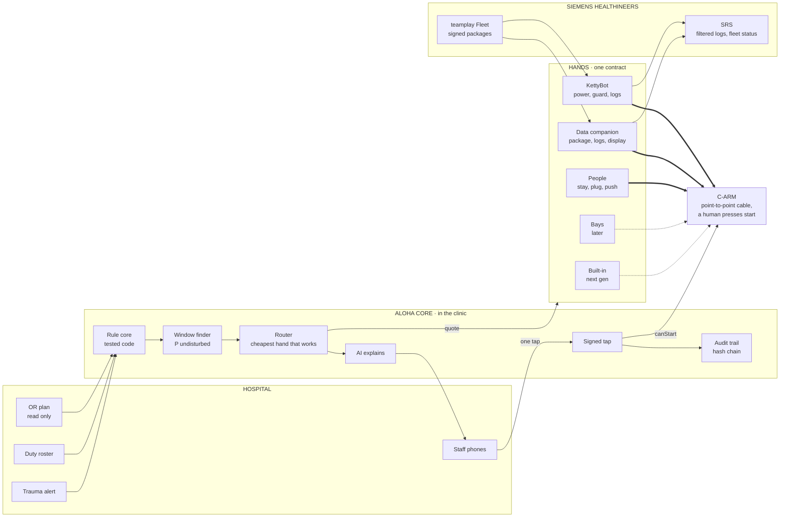
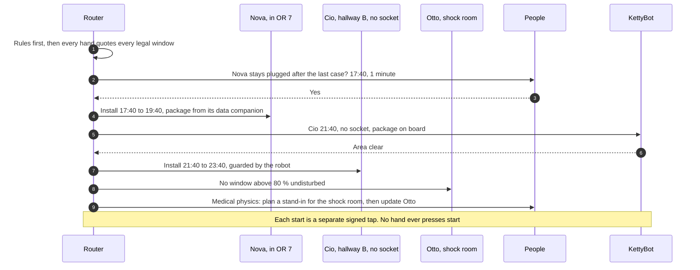

# F · One brain, many hands (recommended)

> Buy the brain first, then let its data decide which hands to buy. Every window goes to the cheapest hand that can really power it that night, and if one hand fails, another one takes the window.

**Verdict.** **We recommend this option.**

- **Stage 1** is the brain, people, and a small data companion on every C-arm. It patches **91 % by the deadline for about €7k** of hardware on a 12-C-arm site: the best buy in our base case.
- **Stage 2** adds one KettyBot for the windows people can't power (nights, no sockets). It reaches **92 %**, and holds at 91 % when evening staff is thin.
- **Later:** bays come with renovations, built-in hands come with Siemens' next generation, and the same brain plans all of them.

This is Christian's architecture line (hospital → Aloha core in the clinic → device and robot ⇄ Siemens) with the hand made pluggable.

**Best for:** this pilot and every site after it. **Not for:** a 30-second pitch, where it should be shown as "one brain, many hands" with the robot on stage.

## Why this one wins

1. **The bottleneck is the window and a responsible human.** Siemens said so: "Nobody feels responsible" (transcript 04). That's the brain. It's software only, it works on the installed base, and every other option needs it anyway.
2. **Data is the cheap half of the hand, and power is the expensive half.** At 17:00 people are still in the house and can power a window: they can leave it plugged in or plug it in. They can't bring a package. A data companion at ≈ €600 can, and it also brings logs and a display that guards the install.
3. **Every single hand fails somewhere.** People at night. Bays where C-arms don't park. Companions on cost and charging. Robots on lifts and capacity. Built-in on the installed base. F routes around each failure.
4. **Spending follows evidence.** After 8 weeks, the audit trail shows exactly which C-arms never get a powered window. That's where a robot or a power companion goes, and nowhere else.

## The stages

| Stage | Hands | Hardware, 12 C-arms | Simulator: patched by the deadline | When |
|---|---|---|---|---|
| **0 · pilot** | Brain + people | €0 | 45 % (91 % if every OR has network) | Weeks 1–8 |
| **1** | + data companion (C1) on every C-arm | ≈ €7k | 91 % | After the pilot |
| **2** | + one KettyBot for what people can't power | ≈ €49k | 92 %; 91 % with thin staff | Where staff is thin or sockets are missing |
| **3** | + bays in renovations, built-in in next gen | Per project | n/a | Years |

## The router

Every hand answers `quote(device, window)` (see the hand contract in `00-reference-architecture.md`). The brain picks the best answer with one line of code (`Documentation/architecture-options/sim/model.js`):

```text
score = P(undisturbed) × P(hand delivers) − 0.004 × clinic minutes
```

Hands are tried cheapest first: leave it plugged after the last case, then plug it in at the socket, then the robot, then push it to a socket as a last resort. Where no hand gets a window above the safety floor, the brain refuses and escalates. In the simulator, that's the shock-room C-arm, which gets a stand-in plan instead of a gamble.

## Architecture



## One evening, three C-arms, three hands



## What it needs

| From | What |
|---|---|
| Siemens | The same as the hands it uses: status data from SRS (Christian's ask #1), a C-arm to test (ask #2), the LAN hand-over, and the answers on power draw and remote wake |
| Hospital | Read-only OR plan and roster, staff messaging, a companion zone; for stage 2, lifts and doors in one area |
| Us | The brain (prototype exists), the router (simulator), the hand contract, C1 firmware, the robot mission (Christian's spec) |

## Pros

- **Value on day one with no hardware,** and every later euro is justified by the brain's own data.
- **It's resilient.** When one hand fails, another takes the window, or the brain moves it to the next night.
- **It fits all three stories at once:** Siemens' favourite (the companion), the team's demo (the robot), and Christian's ask (a pilot, no robot needed to start).
- **Siemens integrates one thing:** the brain and its hand contract. Embodiments can change without touching the integration.
- **It's robust across every scenario we ran.** Stage 2 never drops below 91 %, and its escalations are always within 0.1 per round of the best option.

## Cons

- **More moving parts.** Several hands to integrate, certify and support, so the contract has to be small and versioned.
- **Stage 1 leans on people:** about 6 clinic minutes per patched C-arm, and ≈ 6 declined "push it to a socket" requests per round in the simulator. With thin staff, stage 1 drops to 70 %. That's the trigger for stage 2.
- **The robot in stage 2 keeps its physics:** one install per trip, and a docking adapter.
- **It's harder to say in 30 seconds** than "a robot plugs it in". On stage: *one brain, many hands*, and show the robot.

## Risks and what we do about them

| Risk | What we do |
|---|---|
| Complexity creep | Ship one hand at a time. The contract is four calls. |
| The router trusts a fragile hand | It learns real success per hand and device from the audit trail, and stops quoting a hand that keeps failing |
| "Nobody feels responsible" comes back | Every job names one person, and every start is one signed tap by one role |
| Cost runs ahead of value | Stage 2 hardware only for the C-arms the pilot data shows as unreachable |

## Fit against the challenge

| Criterion | Score |
|---|---|
| Works on today's C-arms unchanged | ●●●●● |
| Power without a socket | ●●●●○ |
| Data without OR Wi-Fi | ●●●●● |
| Guards the install | ●●●●○ |
| Low clinic effort | ●●●○○ |
| Hospital IT acceptance | ●●●●○ |
| Light regulatory load | ●●●○○ |
| Time to a pilot | ●●●●● |
| Low hardware cost | ●●●●○ |
| Scales to many sites | ●●●●● |

## In the simulator

| | Stage 1 (F1) | Stage 2 (F2) | Robot only (D), for contrast |
|---|---|---|---|
| Patched by the deadline, base case | 91 % | 92 % | 92 % |
| Median days to 90 % | 10 | 8 | 8 |
| Clinic minutes per patched C-arm | 6.0 | 3.5 | 3.2 |
| Robot missions per round | 0 | 6.3 | 14.8 |
| Thin evening staff | 70 % | **91 %** | 90 % |
| 30 C-arms, up to 6 a night | **93 %** | 93 % | 68 % |
| No socket near any parking spot | 84 % | **92 %** | 92 % |
| Install shrinks to 30 min | 98 % | 100 % | 100 % |
| Hardware, 12 C-arms | ≈ €7k | ≈ €49k | ≈ €42k |

## The 8-week pilot (Christian's ask #3)

**One hospital · 4–6 C-arms · 8 weeks · no robot needed to start.**

1. **Weeks 1–2:** read-only OR plan import (export or HL7v2), roster by role, device file (where it parks, whether there's a socket, whether there's a network), audit trail. Status data from SRS (ask #1).
2. **Weeks 3–8:** live questions to people and one signed tap per start. C1 on two C-arms. KettyBot on the training-centre C-arm (ask #2) to measure the real draw, the docking and the mission success.
3. **KPIs:** patched by the deadline, clinic minutes per update, zero cases touched, zero unplugged mid-install, logs in hand before every service visit, number of C-arms that never got a powered window. That last number sizes stage 2.

## What would change our mind

| If we learn | Then |
|---|---|
| Installs can shrink to about 30 minutes | People plus data covers almost everything (simulator: 98 %). The robot becomes optional |
| Every OR already has a network link | People alone, €0 hardware (simulator: 91 %) |
| Evening staff is thin everywhere | The robot or the power companion moves into stage 1 |
| It's a new building | Bays first |
| The fleet is next gen | Built-in, with the same brain |

## One-shot build prompt

```text
Build Documentation/architecture-options/prototypes/f-router/: hands.js, router.js, router.test.cjs (Node, no dependencies) and index.html (file://, no network).
Goal: option F as working code, one brain and many hands behind one contract.
hands.js: five adapters implementing quote(device, window), deliver, guard and release from Documentation/architecture-options/00-reference-architecture.md
for people (stay, plug, push), data companion, robot, bay and built-in. Take each adapter's numbers from BreifSim.MODES
in Documentation/architecture-options/sim/model.js, so the prototype and the simulator agree.
router.js: for every pending C-arm, take legal windows from BreifSim.windowsFor, ask every enabled hand to quote, pick the max of
P(undisturbed) x P(deliver) - 0.004 x clinic minutes, and respect MAX_PER_NIGHT, the backup rule and robot capacity
(copy the fits() logic from model.js). It can never start an install: it only prepares a signed-tap request for planner.canStart().
It escalates when nothing is above the 0.8 safety floor.
index.html: hand toggles (people, data companion, robot, bay, built-in), the evening's plan as a timeline per C-arm with the chosen hand,
"why this hand" in one sentence each, and a polytrauma button that replans.
Tests: disabling a hand never breaks a rule, the router never picks a disabled hand, the same seed gives the same plan, escalation works.
Reuse, do not modify: Documentation/architecture-options/sim/engine/*, Documentation/architecture-options/sim/model.js. No questions back, no TODOs, one pass.
```
