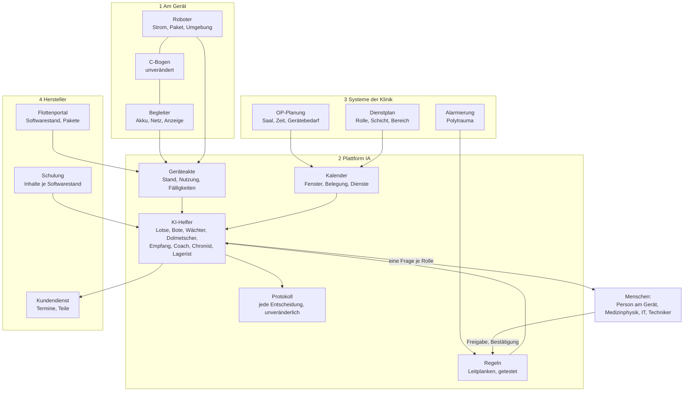
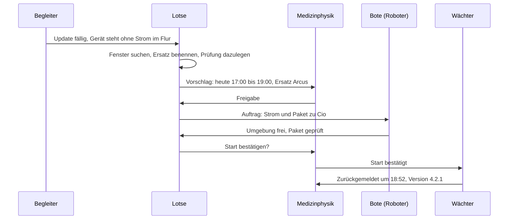
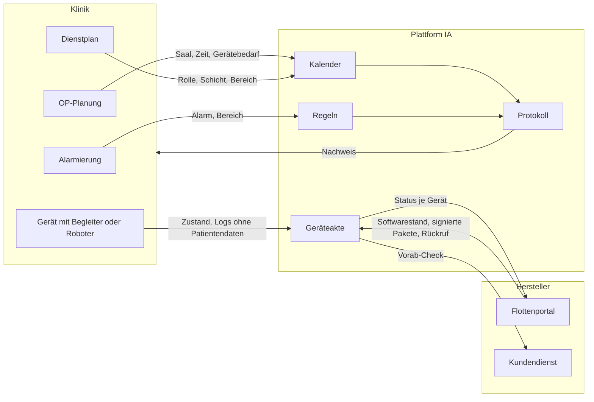

# Challenge 4: Erste Gedanken zur Architektur

Stand: 13.11.2026, nach Christians Antworten im Fragebogen. Eine Skizze für das Gespräch mit den Challenge-Ownern, keine
Systemplanung. Wir kennen die internen Systeme des Herstellers nicht. Alles hier ist `[Annahme]`,
sofern nicht anders markiert. Produktnamen nennen wir nur dort, wo sie im Gespräch gefallen sind.

## Vier Schichten

1. **Am Gerät.** Der C-Bogen bleibt unverändert. Begleiter oder Roboter liefern, was am geparkten
   Gerät fehlt: Strom, Netz, einen Blick auf die Umgebung, und sie nehmen Logs mit.
2. **Plattform.** Drei gemeinsame Bestände (Geräteakte, Kalender, Regeln), darüber die KI-Helfer,
   daneben ein Protokoll.
3. **Systeme der Klinik.** Die Plattform liest Belegung, Dienste und Alarme. Sie schreibt nichts
   in diese Systeme zurück, außer einem Kalendereintrag für das Fenster.
4. **Hersteller.** Softwarestand und Pakete kommen aus dem Flottenportal (im Gespräch genannt:
   teamplay Fleet), der Vorab-Check geht an den Kundendienst, Schulungsinhalte kommen vom Hersteller.

## Leitgedanken

- **Regeln sind Code, die KI ist Vorschlag.** Ob ein Update starten darf, entscheidet eine
  getestete Funktion (im Klickdummy `planner.js`, 15 Tests), kein Sprachmodell. Die KI findet
  Fenster, formuliert Nachrichten und bündelt Dienste. Sie kann keine Leitplanke überstimmen.
- **Ziele statt Schritte.** Die Helfer bekommen ein Ziel („Flotte innerhalb der Fristen aktuell,
  kein Eingriff berührt, möglichst wenig Aufwand für Menschen“) und entscheiden den Weg je Klinik.
- **Keine Patientendaten.** Aus der OP-Planung werden nur Saal, Zeit und Gerätebedarf gelesen,
  aus dem Dienstplan nur Rolle, Schicht und Bereich. Logs werden vor dem Transfer geprüft.
- **Menschen als Rollen.** Die Plattform kennt Funktionen und Dienste, keine Leistungsdaten. Bei
  Einweisungen nur „ja oder nein“.
- **Offline zuerst am Gerät.** Laut Gespräch gibt es im OP oft kein WLAN. Begleiter und Roboter
  tragen Pakete und Logs im eigenen Speicher und gleichen ab, sobald Netz da ist.
- **Jede Entscheidung ist belegt.** Wer hat freigegeben, wer hat bestätigt, was hat der Wächter
  gemeldet. Daraus entstehen die Nachweise für Medizinphysik und IT-Sicherheit.

## Wie die Helfer zusammenarbeiten

Derselbe Ablauf trägt die anderen Dienste. Beim Servicetermin stellt der Empfang den Vorab-Check
zusammen, die Klinik hakt ihre Vorbereitung ab, und die Zusage kommt vom Techniker. Bei der Einweisung schlägt der Coach das
Lernfenster vor, und die Person selbst sagt zu.

## Schnittstellen, die ein Pilot bräuchte

| Schnittstelle | Richtung | Inhalt | Offene Frage |
|---|---|---|---|
| OP-Planung der Klinik | lesen | Saal, Zeit, Gerätebedarf | Welche Systeme sind verbreitet, gibt es einen Standardweg (z. B. HL7 FHIR `[Annahme]`)? |
| Dienstplan | lesen | Rolle, Schicht, Bereich | Darf das ohne Namen geliefert werden? |
| Alarmierung | lesen | Alarm ja oder nein, betroffener Bereich | Gibt es ein Signal, das man abgreifen kann? |
| Flottenportal des Herstellers | lesen, Status schreiben | Softwarestand, Pakete, Rückruf | Was liefert es heute je Gerät? |
| Gerät | über Begleiter oder Roboter | Logs, Zustand, Start des Updates | Welche Signale gibt der C-Bogen im ausgeschalteten Zustand her? |
| Kundendienst | schreiben | Vorab-Check für einen Termin | Wie wird heute disponiert? |
| Teilelager | lesen | Teil vorrätig ja oder nein | Wo liegt der Bestand, beim Hersteller oder im Haus? |
| Rückkanal zum Hersteller | schreiben, je Datenart von der Klinik freigegeben | Softwarestand, Fehlercodes, Nutzungsmuster, Standort | Welche dieser Daten darf und will der Hersteller haben? |

## Datenflüsse

Was fließt wohin, und was fließt nie.

| Datenart | Quelle | Ziel | Verlässt die Klinik |
|---|---|---|---|
| Belegung (Saal, Zeit, Gerätebedarf) | OP-Planung | Kalender | nein |
| Dienste (Rolle, Schicht, Bereich) | Dienstplan | Kalender | nein |
| Eingewiesen ja oder nein | Medizinphysik | Regeln | nein |
| Gerätezustand und Logs | Gerät | Geräteakte, Flottenportal | ja, ohne Patientendaten und geprüft |
| Softwarestand und Pakete | Flottenportal | Geräteakte, Gerät | kommt vom Hersteller |
| Vorab-Check | Geräteakte, Kalender | Kundendienst | ja, nach Zusage der Klinik |
| Nutzungsmuster | Geräteakte | Hersteller | nur, wenn die Klinik die Datenart freigibt |
| Bilder der Roboterkamera | Roboter | nirgends | nein, sie werden im Roboter ausgewertet und nicht gespeichert |
| Patientendaten | keine | keine | nein, sie werden nie gelesen |

## Was wir bewusst offenlassen

- Wo die Plattform läuft (beim Hersteller, in der Klinik, beides).
- Welches Modell die Helfer antreibt. Die Architektur hängt nicht daran, solange die Regeln
  außerhalb des Modells liegen.
- Die regulatorische Einordnung. Der Klickdummy ist kein Medizinprodukt. Ob eine Plattform, die
  Updates von Medizingeräten plant, als Zubehör oder als eigenständige Software zu bewerten ist,
  muss der Hersteller klären.
