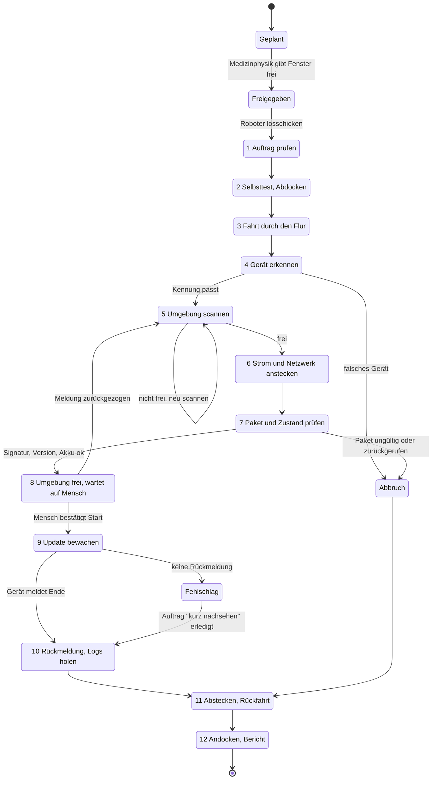
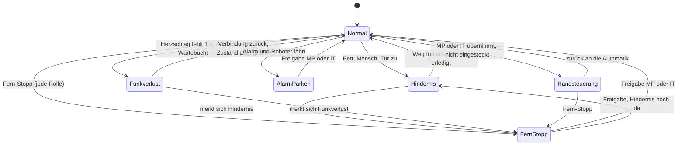

# Robot Operational Cockpit: Spec, Testfälle, Evals, Stresstests

Stand: 13.11.2026. Entwicklungs-Vorbereitung für das Cockpit, mit dem die Klinik den Roboter
C-ARMAGOTCHI überwacht und führt. Nichts davon ist gebaut, außer dem, was der Klickdummy zeigt
(`../klickdummy/`). Alle Personen, Orte, Grenzwerte und Zeiten sind erfunden oder `[Annahme]`.
Kein Medizinprodukt, kein Produkt von Siemens Healthineers.

## 1. Ergebnis zuerst

**Das Cockpit ist die Stelle, an der Menschen dem Roboter vertrauen können, ohne neben ihm zu
stehen.** Es zeigt in drei Sekunden, wo der Roboter ist, was er tut und warum er steht. Es lässt
jede Rolle anhalten und nur Medizinphysik und IT-Abteilung freigeben oder von Hand steuern. Wo
ein Mensch vor Ort gebraucht wird, fragt es genau eine freie Person in der Nähe, nach dem
Fahrdienst-Prinzip, und vergisst danach, wer es war.

Der Roboter bleibt bewusst sichtbar und avantgardistisch. Er ist die Hand, das Auge und das
Gesicht der Plattform. Das Cockpit sorgt dafür, dass diese Hand jederzeit kontrolliert wirkt.

### Was das Cockpit nicht ist

- **Keine Sicherheitssteuerung.** Der sichere Halt liegt im Roboter selbst (Not-Halt-Taster am
  Gehäuse, sicherheitsgerichtete Laserscanner, Bremsen). Der Fern-Stopp im Cockpit ist ein
  Software-Stoppbefehl, kein Not-Halt. Er ist schnell, aber nicht sicherheitsgerichtet.
- **Kein Ersatz für den Flottenmanager des Herstellers.** Wir nehmen einen handelsüblichen
  Klinik- oder Service-AMR (autonomer mobiler Roboter) mit eigenem Flottenmanager an. Der
  Flottenmanager plant Pfade, vermeidet Kollisionen und steuert Türen und Aufzüge. Das Cockpit
  sitzt darüber und gibt Missionen, Halte- und Freigabebefehle `[Annahme]`.
- **Kein Startknopf für Updates im Roboter.** Der Roboter startet nie ein Update. Er meldet
  „Umgebung frei“, ein Mensch bestätigt den Start aus der Ferne.

### v1 (Hackathon und Pilot) gegen Ausblick

| Thema | v1 | Ausblick |
|---|---|---|
| Roboter | einer, simuliert im Klickdummy, im Pilot ein gekaufter AMR | mehrere Roboter je Haus |
| Aufgaben | Update-Mission in 12 Schritten, Logs holen | Nachtschicht mit Fähigkeiten: Abendrunde, Akkus pflegen, Teile bringen, Techniker lotsen, Einweisung begleiten |
| Geräte bewegen | verboten, Regel „bewegt keinen C-Bogen“ | fernste Vision mit eigener Sicherheitsbetrachtung, bis dahin ein Auftrag an eine Person |
| Updates mit Armbewegung | nie aus der Ferne, Aufsicht durch eingewiesene Funktion | Roboter sichert den Raum und meldet „leer“, Mensch beaufsichtigt |
| Bereich | nur Flure, nie OP-Saal, nie steriler Bereich | weitere Bereiche nach Hausordnung |
| Personen | Funktion und Schicht, eingeteilter Bereich | unverändert, keine Ortung |

### Normen und Rahmen (nur als Hinweis, vor Nutzung prüfen)

| Norm oder Rahmen | Warum relevant | Marke |
|---|---|---|
| ISO 3691-4 (fahrerlose Flurförderzeuge und ihre Systeme) | Schutzfelder, Geschwindigkeit, Betrieb in Bereichen mit Personen | `[Suchtreffer]` |
| ISO 13482 (Serviceroboter für persönliche Assistenz) | Sicherheit mobiler Serviceroboter nahe Menschen | `[Suchtreffer]`, Passung für Klinik-AMR offen |
| IEC 61508, ISO 13849-1 | Funktionale Sicherheit, Performance Level für Not-Halt und Schutzfelder | `[Suchtreffer]` |
| ISO 13850 | Not-Halt ist ein festverdrahtetes Befehlsgerät an der Maschine. Deshalb heißt der Cockpit-Knopf „Fern-Stopp“ | `[Annahme]` |
| ISO 10218 | Steckt der Roboter mit einem Arm selbst ein (Synthese: „fährt hin, steckt ein“), gilt für den Arm ISO 10218 (kollaborierender Betrieb), nicht nur ISO 3691-4 | `[Annahme, vor Nutzung prüfen]` |
| IEC 60601-1 | Strom und Daten an den C-Bogen bilden eine Kombination, die der Hersteller des C-Bogens freigeben muss (6.1) | `[Annahme, Frage an Siemens]` |
| Maschinenverordnung (EU) 2023/1230 | Ab 20.01.2027, betrifft den Roboter samt Steuerung. Das Cockpit kann als Überwachungsfunktion autonomer mobiler Maschinen gelten (Anhang III, Nr. 3.2.4); das klärt der Roboter-Hersteller | `[Suchtreffer]`; Einordnung, Nummer `[Annahme, vor Nutzung prüfen]` |
| IEC 80001-1, IEC 62443 | Roboter als Teilnehmer im Kliniknetz neben Medizingeräten | `[Suchtreffer]`, siehe `../research/02-regulatorik-security.md` |
| VDA 5050 | Offene Schnittstelle Flottensteuerung zu Fahrzeug, Kandidat für die Kopplung | `[Suchtreffer]` |
| EU AI Act | Sicherheitsfunktion beim zertifizierten Laserscanner ohne lernendes Verfahren, Kamera-KI nur Zusatzmeldung, so voraussichtlich kein Sicherheitsbauteil | `[Annahme, rechtlich klären]` |
| DSGVO, BetrVG § 87 Abs. 1 Nr. 6 | Kamera und Lidar im Flur, Aufträge an Beschäftigte, technische Überwachung | `[Suchtreffer]`, Personalrat und Datenschutz einbinden |

## 2. Rollen und Rechte

Drei Rollen bedienen das Cockpit. Welche Funktion die Rollen Medizinphysik und IT-Abteilung
ausfüllt (Strahlenschutzbeauftragte, Medizintechnik), legt das Haus fest. Weitere Funktionen (MTR,
OP-Pflege, Medizintechnik im Rufdienst) erscheinen nur als Empfänger von Aufträgen.

| Aktion | Person am Gerät | Medizinphysik | IT-Abteilung | Lotse (KI) | Roboter |
|---|---|---|---|---|---|
| Lagebild sehen (Karte, Roboter, Geräte) | eigener Bereich | ja | ja | liest | meldet |
| Kamera- und Lidar-Ansicht | Umrisse | Umrisse | Umrisse | nein | wertet aus |
| Fern-Stopp | **ja** | **ja** | **ja** | nein | Hardware-Not-Halt am Gehäuse für jeden |
| Freigabe nach Fern-Stopp oder Alarm | nein | **ja** | **ja** | nein | nein |
| Von Hand steuern | nein | **ja** | **ja** | nein | nein |
| Mission starten (Roboter losschicken) | nein | ja, nach Fenster-Freigabe | nein `[Annahme]` | vorschlagen | nein |
| Mission abbrechen | nein, aber „Ich brauche das Gerät“ | ja | ja | vorschlagen | nein |
| Paket für das Haus zulassen | nein | nein | ja, mit Medizintechnik | nie | nie |
| Start des Updates bestätigen | nein | ja | ja, nur Sicherheitsupdates `[Annahme]` | nie | nie |
| Auftrag annehmen oder ablehnen | ja, nur wenn gefragt | nein | nein | nein | nein |
| Auftrag anlegen | nein | ja | ja | ja, aus Ereignissen | löst aus |
| Auftrag zurückziehen | nein | ja | nein `[Annahme]` | nein | nein |
| Fähigkeiten der Nachtschicht planen | nein | ja | ja (Logs, Sicherheitslisten) | vorschlagen | nein |
| Protokoll lesen | eigene Aufträge, solange offen | ja | ja | schreibt | schreibt |

Regeln dazu:

- **Fern-Stopp schlägt alles.** Er gilt auch dann, wenn eine andere Person gerade von Hand steuert.
  Der Hardware-Not-Halt am Roboter wirkt unabhängig vom Cockpit.
- **Ablehnen kostet nichts.** Es gibt keine Begründungspflicht, keinen Zähler, keine Rangliste.
- **Der Leitstand kann nicht für die Person am Gerät antworten** (im Klickdummy geprüft).

## 3. Zustandsautomaten

Der Roboter hat zwei voneinander unabhängige Ebenen, wie im Klickdummy (`r.step`, `r.hold`,
`r.prev`): **den Missionsschritt** (wo im Ablauf er ist) und **den Haltegrund** (warum er gerade
steht). Haltegründe stapeln sich. Wird ein Fern-Stopp freigegeben, bleibt ein Hindernis darunter
bestehen.

### 3.1 Mission (12 Schritte des Klickdummys)

### 3.2 Haltegründe (überlagern jeden Schritt)

### 3.3 Verbotene Übergänge

Jeder Eintrag ist eine harte Regel im Code mit eigenem Test, nicht nur eine UI-Sperre.

| ID | Verboten | Stattdessen | Klickdummy |
|---|---|---|---|
| V-01 | „Umgebung frei“ melden, solange ein Haltegrund besteht | erst nach Freigabe und neuem Scan | ja |
| V-02 | Fern-Stopp, Not-Halt, Alarm oder Funkverlust ohne Rückzug einer gegebenen Meldung | Meldung zurückziehen, Mission auf Schritt 5 (neu scannen) | ja |
| V-03 | Wegfahren (automatisch oder von Hand), solange eingesteckt | erst abstecken (Schritt 11) | ja |
| V-04 | Roboter startet ein Update | nur ein Mensch bestätigt | ja |
| V-05 | Weiterfahrt nach Fern-Stopp oder Alarm ohne Freigabe von MP oder IT | wartet | ja |
| V-06 | Neue Aufgabe oder normale Fahrt ohne Verbindung zum Cockpit | Schleichfahrt zur Wartebucht (ROC-N-03), eingesteckt stehen bleiben | teils |
| V-07 | Start mit einer Meldung, die älter als 5 Minuten ist `[Annahme]` | neu scannen | nein |
| V-08 | Abstecken während das Update läuft | bewachen bis Ende oder Fehlschlag | ja |
| V-09 | Paket übergeben, das signaturlos oder zurückgerufen ist | Abbruch, Meldung an IT | teilweise |
| V-10 | Fern-Start bei Update mit Armbewegung | Auftrag „Aufsicht“ an eingewiesene Funktion | ja |
| V-11 | Abdocken ohne Fenster-Freigabe | Mission bleibt „geplant“ | ja |
| V-12 | C-Bogen bewegen, Bremse lösen, Strahlung auslösen | Auftrag an eine Person | ja (Regeltext) |
| V-13 | Fahrt in OP-Saal oder sterilen Bereich, auch von Hand | Fahrt endet an der Flurgrenze | ja |
| V-14 | Abfahrt mit Akku unter Reserve für Rückweg plus Update | Mission nicht starten | nein |

## 4. Funktionale Anforderungen

### Lagebild

| ID | Anforderung |
|---|---|
| ROC-F-01 | Karte des Stockwerks mit Roboter, Geräten, Station, Flurgrenzen und gesperrten Bereichen (OP-Säle). |
| ROC-F-02 | Je Roboter eine Zeile: Betriebsart, Haltegrund, Missionsschritt n von 12, Akku, Verbindung, Alter der letzten Meldung. |
| ROC-F-03 | Personen im Dienst nur als Funktion und Schicht am eingeteilten Bereich. Wer im Eingriff oder nicht im Dienst ist, erscheint nur als Zahl. |
| ROC-F-04 | Veraltete Daten sind als veraltet erkennbar („Stand vor 40 s“), nie als live. |

### Missionsplanung aus dem Scheduling

| ID | Anforderung |
|---|---|
| ROC-F-05 | Missionen entstehen nur aus einem freigegebenen goldenen Fenster (`planner.js`, `canStart`). Der Lotse schlägt Route und Reihenfolge vor, die Medizinphysik schickt los. |
| ROC-F-06 | Vor dem Abdocken prüft das Cockpit: Fenster frei, Paket signiert und nicht zurückgerufen, Akku reicht, Route ohne bekannte Funklöcher, kein Alarm im Bereich. |
| ROC-F-07 | Höchstens zwei Geräte je Nacht und Roboter in v1 (Regel aus `planner.js`), Reihenfolge nach Frist. |

### Live-Status und Wahrnehmung

| ID | Anforderung |
|---|---|
| ROC-F-08 | Umgebungsscan als Checkliste: niemand im Umkreis von 2 m, Fluchtweg mindestens 1,2 m, Gerät gebremst, kein steriler Bereich, Kabel nicht im Laufweg `[Annahme: Werte]`. |
| ROC-F-09 | „Umgebung frei“ ist eine laufende Aussage. Tritt in Schritt 8 jemand hinzu, zieht der Roboter die Meldung sofort zurück. |
| ROC-F-10 | Die Startbestätigung zeigt die Meldung des Roboters im Wortlaut und ihr Alter. Ohne gültige Meldung gibt es keinen Startknopf. |

### Ausnahmen

| ID | Ausnahme | Verhalten des Roboters | Was das Cockpit zeigt |
|---|---|---|---|
| ROC-F-11 | Hindernis (Bett, Wagen) | hält, hält Fluchtweg frei, wartet | Haltegrund, Knopf „Hilfe in der Nähe anfragen“ |
| ROC-F-12 | Mensch im Weg | hält, spricht freundlich an, fährt nach Freiwerden selbst weiter | Hinweis, kein Alarm |
| ROC-F-13 | Tür zu | wartet am Flottenmanager-Signal, nach 2 min `[Annahme]` Auftrag „Tür öffnen“ | Haltegrund mit Tür-Kennung |
| ROC-F-14 | Aufzug belegt oder gestört | wartet, nach Zeitlimit Umkehr zur Station | Haltegrund, Mission verschoben |
| ROC-F-15 | Akku knapp | Mission nur, wenn Reserve reicht. Unterwegs unter Schwelle: Abbruch vor dem Einstecken, Rückfahrt | Warnung, Mission neu geplant |
| ROC-F-16 | Funkloch | wie ROC-N-03: Schleichfahrt zur Wartebucht, eingesteckt bleibt er stehen. Laufendes Update läuft am Gerät weiter. Bei Rückkehr der Verbindung Abgleich, neuer Scan | Roboter grau, „letzter Stand vor n s“ |
| ROC-F-17 | Kabel passt nicht oder Stecker hält nicht | kein zweiter Versuch mit Kraft, Abbruch, Logs ohne Update | Auftrag an Medizintechnik |
| ROC-F-18 | Falsches Gerät an der Stelle | kein Einstecken, Abbruch | Hinweis an Medizinphysik, Geräteakte prüfen |
| ROC-F-19 | Gerät meldet sich nach dem Update nicht zurück | bleibt stehen und bewacht | kritische Meldung, Auftrag „kurz nachsehen“, Ersatzgerät |

### Übergabe an Menschen (Aufträge nach Fahrdienst-Prinzip)

| ID | Anforderung |
|---|---|
| ROC-F-20 | Aufträge entstehen nur aus drei Anlässen: Roboter kommt nicht weiter, Gerät meldet sich nicht zurück, Update braucht Aufsicht. |
| ROC-F-21 | Gefragt wird genau eine Person zugleich, die nächste zuerst, nur im Dienst und laut Plan frei. Der Rufdienst kommt zuletzt. |
| ROC-F-22 | Niemand hat zwei offene Anfragen zugleich. Ältester Auftrag zuerst. |
| ROC-F-23 | Ablehnen geht mit einem Tipp, ohne Grund. Der Auftrag geht an die nächste Person. |
| ROC-F-24 | Wer in einen Eingriff geht oder den Dienst beendet, gibt einen angenommenen Auftrag automatisch zurück. |
| ROC-F-25 | Aufsicht bei Update mit Armbewegung nur an eingewiesene Funktionen (Annahme: MTR, Medizintechnik). Abschluss durchläuft dieselbe Startprüfung wie ein Fern-Start. |
| ROC-F-26 | Nach Erledigung wird gelöscht, wer den Auftrag hatte und wer abgelehnt hat. Es bleibt nur „erledigt um“ und die Zahl je Schicht. |
| ROC-F-27 | Findet sich niemand, liegt der Auftrag bei der Medizinphysik, sichtbar im Leitstand. |

### Alarm, Protokoll, Nachtschicht

| ID | Anforderung |
|---|---|
| ROC-F-28 | Alarm (z. B. Polytrauma) aus der Alarmierung: Fährt der Roboter, fährt er an die Wand und wartet auf Freigabe. Steht er am Gerät, zieht er „Umgebung frei“ zurück. Ein noch nicht gestartetes Fenster wird gesperrt und neu geplant. Ein laufendes Update wird nicht abgebrochen, das Cockpit nennt ein Ersatzgerät. |
| ROC-F-29 | „Ich brauche das Gerät“ (Person am Gerät): wie Alarm für dieses eine Gerät. Der Stecker ist magnetisch und löst sich bei Zug `[Annahme]`, niemand muss warten. |
| ROC-F-30 | Protokoll ohne Lücke: jeder Befehl mit Rolle, Zeit, Befehls-ID, Ergebnis. Unveränderlich (Chronist darf nie ändern oder löschen). Keine Namen in Auftragseinträgen nach Abschluss. |
| ROC-F-31 | Nachtschicht 17 bis 7 Uhr als Zeitleiste mit Fähigkeiten-Karten. Jede Fähigkeit hält dieselben Regeln ein (kein OP-Saal, kein Start, keine Bilder, kein Gerät bewegen). „Gerät an den Ort bringen“ bleibt als Vision markiert und ist nicht planbar. |
| ROC-F-32 | Einsatzbericht nach jeder Mission in der Geräteakte: Schritte, Haltegründe, Dauer, Versionsstand, Logs übertragen ja oder nein. |

## 5. UI-Anforderungen

| ID | Anforderung | Prüfung |
|---|---|---|
| ROC-U-01 | **Alarmhierarchie in drei Stufen.** Kritisch (Fern-Stopp, Not-Halt am Roboter, Alarm, Fehlschlag, Funkverlust bei laufendem Update): rotes Band oben auf jeder Seite, bleibt bis bestätigt, `role="alert"`. Warnung (Hindernis, Akku knapp): gelb in der Roboterzeile. Info: Protokoll. | kein kritischer Zustand als Toast |
| ROC-U-02 | Toasts nur für Rückmeldungen auf eigene Klicks („Freigeben dürfen nur…“), nie für Zustände des Roboters. | Code-Review |
| ROC-U-03 | **Eine Frage je Rolle.** Person am Gerät: „Annehmen oder ablehnen?“. Medizinphysik: „Start bestätigen?“ oder „Freigeben?“. IT-Abteilung: „Paket und Netz in Ordnung?“. | Usability-Eval |
| ROC-U-04 | **Lagebild in 3 Sekunden.** Oben: ein Satz in Ich-Form vom Roboter („Ein Bett steht im Flur B. Ich warte.“). Farbe und Form des Roboter-Symbols kodieren den Haltegrund doppelt (nicht nur Farbe). | Usability-Eval, Aufgabe A2 |
| ROC-U-05 | Fern-Stopp auf jeder Roboter- und Leitstandseite an fester Stelle, mindestens 44 × 44 px, ohne Bestätigungsdialog. Freigeben dagegen mit Bestätigung. | Screenshot |
| ROC-U-06 | Gesperrte Aktionen sind sichtbar deaktiviert und nennen den Grund („eingesteckt, erst abstecken“). | Test |
| ROC-U-07 | Nachtmodus: dunkle Fläche, gedimmte Helligkeit, Rot bleibt rot. Automatisch nach Uhrzeit, von Hand umschaltbar. | Screenshot |
| ROC-U-08 | Barrierefreiheit grob nach WCAG 2.2 AA `[Annahme]`: Kontrast, Tastatur (Fern-Stopp mit fester Taste), Bildschirmleser liest Haltegrund vor, keine reine Farbinformation. | axe-Lauf, Tastaturtest |
| ROC-U-09 | Deutsch und Englisch, kurze Sätze. Sicherheitstexte aus festen Vorlagen. | Sprachprüfung in `check.mjs` |
| ROC-U-10 | Hinweis „kein Medizinprodukt, erfundene Daten“ sichtbar, solange Demo. | Screenshot |

## 6. Nichtfunktionale Anforderungen

| ID | Anforderung | Zielwert `[Annahme]` |
|---|---|---|
| ROC-N-01 | **Der Fern-Stopp im Cockpit ist kein Not-Halt** (ISO 13850). Der sichere Halt liegt im Roboter (Hardware-Not-Halt, Schutzfelder, Watchdog). Das steht in der UI-Hilfe und im Betriebshandbuch. | Pflicht |
| ROC-N-02 | Latenz Fern-Stopp vom Klick bis Stoppbefehl am Roboter | p95 unter 300 ms im Kliniknetz, Anzeige „gehalten“ nach Bestätigung des Roboters, nicht nach dem Klick |
| ROC-N-03 | Verbindungsverlust: Herzschlag alle 200 ms. Ohne Herzschlag seit 1 s keine neue Aufgabe, Schleichfahrt. Der Roboter fährt mit eigenen Schutzfeldern zur nächsten Wartebucht und hält dort. Ist keine erreichbar, hält er am Rand und lässt 1,2 m Fluchtweg frei. Eingesteckt bleibt er stehen und bewacht (V-08). Werte `[Annahme]` | Watchdog im Roboter, nicht im Cockpit |
| ROC-N-04 | Offline: Das Cockpit läuft im Kliniknetz ohne Internet. Fällt das Cockpit aus, verhält sich der Roboter wie bei Verbindungsverlust (ROC-N-03) | Demo ohne WLAN lauffähig (Projektregel) |
| ROC-N-05 | Zeitsynchronität: Roboter und Ladestation bekommen die Zeit vom Knoten, jedes Ereignis trägt eine fortlaufende Nummer. Reihenfolge nach Nummer, nicht nach Uhrzeit | unter 100 ms zwischen Knoten und Roboter; gegenüber fremden Systemen gilt 2 min (SCH-N-07) |
| ROC-N-06 | Befehle sind idempotent: jede Aktion trägt eine Befehls-ID, Doppelklicks und Wiederholungen wirken einmal | Test T-24 |
| ROC-N-07 | Steuerrecht: Von Hand steuert genau eine Person. Das Cockpit zeigt, wer (Rolle und Bildschirm). Übernahme nur nach Abgabe oder durch Fern-Stopp | Test T-26 |
| ROC-N-08 | **Datenschutz Kamera und Lidar:** Auswertung im Roboter, keine Bilder gespeichert oder übertragen. Nach außen gehen nur „Person im Umkreis ja oder nein“ und Umrisse ohne Gesicht. Karten enthalten nur feste Hindernisse, keine Bewegungsspuren | Prüfung mit Netzmitschnitt |
| ROC-N-09 | Keine Gesundheitsdaten: Logs werden vor Transfer gefiltert (nur freigegebene Felder). Kein Personenbezug in URLs, `localStorage`, Analytics | Code-Review, `healthcare-reviewer` |
| ROC-N-10 | Rechte serverseitig prüfen. Die UI-Sperre ist Komfort, nicht Schutz | Test T-11 bis T-14 gegen die API |
| ROC-N-11 | Protokoll manipulationssicher (verkettete Hashes) und mindestens so lange aufbewahrt wie die Nachweise der Medizinphysik | offen, mit IT klären |
| ROC-N-12 | Sicherheit im Netz: Roboter in eigenem Segment, signierte Befehle, Updates des Roboters selbst über denselben Prozess wie Medizingeräte | IEC 80001-1, Netzkonzept der Klinik |

### 6.1 Gefährdungen durch Kabel und Strom

Maßnahmen `[Annahme]`, mit Sicherheitsfachkraft und Herstellern festlegen. H = Hersteller des C-Bogens.

| Gefährdung | Maßnahme | Zuständig |
|---|---|---|
| Stolpern über das Kabel | Kabel kurz und am Boden geführt, Scan prüft „Kabel nicht im Laufweg“ (ROC-F-08) | Roboter-Hersteller |
| Fluchtweg verengt | Parken nur mit 1,2 m Restbreite, Wartebuchten je Flur (ROC-N-03) | Klinik, Brandschutz |
| Arm oder Stecker drückt mit Kraft | Steckkraft begrenzt, kein zweiter Versuch (ROC-F-17), Person im Umkreis stoppt den Arm (ISO 10218) | Roboter-Hersteller |
| Zug am Kabel, Gerät rollt | magnetischer Stecker löst sich (ROC-F-29), Gerät gebremst (ROC-F-08) | Roboter-Hersteller |
| Akku als Brandlast im Flur | Zellüberwachung, nachts an der Ladestation, Parken nur an freigegebenen Stellen | Roboter-Hersteller, Brandschutz |
| Stromquelle am Medizingerät: Ableitstrom, Schutzleiter (IEC 60601-1) | nur an der Parkposition, nie mit Patient am Gerät, Stromquelle von H freigegeben | H `[Frage an Siemens]` |
| Datenleitung koppelt Potenziale | Datenleitung galvanisch getrennt | H, Roboter-Hersteller |
| Abstecken während des Updates | Roboter steckt nicht ab (V-08); zieht ein Mensch, meldet das Cockpit Fehlschlag und Ersatz | H, Medizinphysik |
| Akku des Roboters leer im Update | Reserve für Update plus Rollback, sonst keine Mission (V-14) | Roboter-Hersteller |
| beschädigtes Kabel | Selbsttest vor jeder Mission (Schritt 2), Sichtprüfung in der Instandhaltung | Medizintechnik |

## 7. Testfälle

Spalte KD: **ja** heißt, der Klickdummy zeigt es heute und `tools/check.mjs` prüft es. **teils**
heißt sichtbar, aber nicht vollständig oder nicht geprüft. **nein** heißt neu für die Entwicklung.

| ID | Gegeben | Wenn | Dann | KD |
|---|---|---|---|---|
| ROC-T-01 | Fenster freigegeben, Roboter an Station | MP schickt Roboter los | 12 Schritte laufen ab, kein Startknopf vor Schritt 8 | ja |
| ROC-T-02 | Roboter in Schritt 8 | MP bestätigt Start | Update läuft, Roboter bewacht, nach Ende Logs, Rückfahrt, Bericht in Akte | ja |
| ROC-T-03 | Fenster nur Vorschlag | MP will Roboter losschicken | nicht möglich, Grund „Freigabe fehlt“ | ja |
| ROC-T-04 | Roboter fährt | Bett im Flur | Haltegrund Hindernis, keine Meldung „frei“ | ja |
| ROC-T-05 | Hindernis | MP fragt Hilfe an, Person erledigt | Roboter fährt weiter, Auftrag geschlossen | ja |
| ROC-T-06 | Hindernis | Flur wird von selbst frei | Auftrag schließt ohne Eintrag, wer gefragt war | ja |
| ROC-T-07 | Roboter vor Tür | Tür bleibt 2 min zu | Auftrag „Tür öffnen“ an nächste freie Person | nein |
| ROC-T-08 | Aufzug gestört | Zeitlimit erreicht | Umkehr zur Station, Mission neu geplant | nein |
| ROC-T-09 | Akku reicht nicht für Rückweg plus Reserve | Mission soll starten | kein Abdocken, Warnung | nein |
| ROC-T-10 | Roboter fährt | Funk bricht ab | nach 1 s Schleichfahrt zur Wartebucht, Meldung zurückgezogen | teils |
| ROC-T-11 | Fern-Stopp aktiv | Person am Gerät will freigeben | verweigert mit Grund, Halt bleibt | ja |
| ROC-T-12 | Roboter fährt | Person am Gerät drückt Fern-Stopp | Roboter steht | ja |
| ROC-T-13 | Roboter nicht eingesteckt | Person am Gerät will von Hand steuern | verweigert | teils |
| ROC-T-14 | Handsteuerung durch IT | Lenkbefehl Richtung OP-Saal | Roboter bleibt an der Flurgrenze | ja |
| ROC-T-15 | Roboter eingesteckt (Schritt 6 bis 10) | MP will von Hand steuern | Knopf gesperrt, Grund „eingesteckt“ | ja |
| ROC-T-16 | „Umgebung frei“ gemeldet | Fern-Stopp | Meldung zurückgezogen, kritisches Band auf allen Seiten, kein Startknopf | ja |
| ROC-T-17 | Fern-Stopp nach Meldung | MP gibt frei | Roboter scannt neu, meldet erneut, erst dann Start möglich | ja |
| ROC-T-18 | Hindernis, darauf Fern-Stopp | Freigabe | Hindernis besteht weiter | ja |
| ROC-T-19 | Fern-Stopp in jedem der 12 Schritte (parametrisiert) | Fern-Stopp | Roboter steht, laufendes Update läuft am Gerät weiter, kein Abstecken | teils |
| ROC-T-20 | Roboter fährt | Polytrauma-Alarm | fährt an die Wand, wartet auf Freigabe MP oder IT | ja |
| ROC-T-21 | Roboter in Schritt 8 am angeforderten Gerät | Alarm | Meldung zurückgezogen, Fenster neu geplant, Stecker lässt sich abziehen | teils |
| ROC-T-22 | Update läuft | Alarm | Update wird nicht abgebrochen, Ersatzgerät genannt | ja |
| ROC-T-23 | Roboter auf dem Weg zum angeforderten Gerät | Alarm | an die Wand, nach Freigabe zurück zur Station (KD lässt den Roboter heute verschwinden) | teils |
| ROC-T-24 | Roboter fährt | Fern-Stopp doppelt in 50 ms | ein Protokolleintrag, ein Befehl | nein |
| ROC-T-25 | Bereit | Start zweimal bestätigt (zwei Klicks) | ein Start | nein |
| ROC-T-26 | MP steuert von Hand | IT will übernehmen | verweigert, Anzeige „Steuerung bei MP“; Fern-Stopp von IT wirkt sofort | nein |
| ROC-T-27 | MP und IT sehen dasselbe Cockpit | IT gibt frei, MP drückt gleichzeitig Fern-Stopp | Fern-Stopp gewinnt, beide sehen denselben Endzustand | nein |
| ROC-T-28 | Meldung „frei“ älter als 5 min | MP will starten | kein Start, Roboter scannt neu | nein |
| ROC-T-29 | Paket zurückgerufen während Fahrt | Schritt 7 | Abbruch, keine Übergabe, Meldung an IT | nein |
| ROC-T-30 | Person tritt in Schritt 8 an das Gerät | Scan läuft weiter | Meldung zurückgezogen, kein Startknopf | nein |
| ROC-T-31 | Kabel hält nicht | Einstecken | kein zweiter Versuch mit Kraft, Auftrag an Medizintechnik | nein |
| ROC-T-32 | Auftrag offen, drei Personen frei | Auftrag entsteht | nur die nächste sieht ihn, andere nicht | ja |
| ROC-T-33 | Person im Eingriff oder nicht im Dienst | Auftrag entsteht | sieht nichts, erscheint im Leitstand nur als Zahl | ja |
| ROC-T-34 | Gefragte Person lehnt ab | Ablehnen | nächste Person wird gefragt, kein Zähler, keine Begründung | ja |
| ROC-T-35 | Zwei offene Aufträge, eine freie Person | Verteilung | Person bekommt nur einen, ältester zuerst | teils |
| ROC-T-36 | Person hat Auftrag angenommen | geht in Eingriff | Auftrag wieder offen, nächste Person gefragt | ja |
| ROC-T-37 | Auftrag erledigt | Abschluss | keine Spur, wer ihn hatte oder abgelehnt hat | ja |
| ROC-T-38 | Aufsicht für Update mit Armbewegung, nächste Person ist OP-Pflege | Verteilung | übersprungen, MTR oder Medizintechnik gefragt | ja |
| ROC-T-39 | Aufsicht erledigt, aber Alarm im Saal | Abschluss | kein Start, Grund aus `canStart` | teils |
| ROC-T-40 | Niemand frei | Auftrag entsteht | liegt bei Medizinphysik, Rufdienst zuletzt | teils |
| ROC-T-41 | Leitstand | will Auftrag für Person am Gerät annehmen | nicht möglich | ja |
| ROC-T-42 | Mission läuft | Seite neu laden | Zustand bleibt erhalten, keine Personendaten im Browser-Speicher | ja |
| ROC-T-43 | Nachtschicht | „Gerät an den Ort bringen“ antippen | als Vision markiert, nicht planbar | ja |

## 8. Evals

### 8.1 Wahrnehmung „Umgebung frei“

Die teure Fehlerart ist **falsch frei**: Ein Mensch ist da, der Roboter meldet frei. Sie muss
gegen 0 gehen. „Falsch nicht frei“ kostet nur Zeit.

| Punkt | Festlegung |
|---|---|
| Szenarien-Set | mindestens 300 Szenen in Simulation, 100 im echten Flur: Person steht, hockt hinter dem C-Bogen, sitzt im Rollstuhl, liegt im Bett, Reinigung mit Wagen, Person halb hinter Vorhang, Dunkelheit, Glasflächen und Spiegel, schwarze Kleidung (schlechte Lidar-Reflexion), Kabel am Boden, Gerät ungebremst, Fluchtweg 1,1 m |
| Metrik | Anteil falsch frei, Anteil falsch nicht frei, Zeit bis zum Rückzug nach Hinzutreten |
| Ziel `[Annahme]` | 0 falsch frei im Set. Bei 0 von 300 liegt die obere 95-Prozent-Grenze bei etwa 1 Prozent (Dreierregel 3/n). Deshalb ist die Wahrnehmung nie die einzige Sicherung: Mensch bestätigt, Gerät hat eigene Verriegelungen |
| Ziel falsch nicht frei | unter 10 Prozent |
| Rückzug | unter 1 s nach Eintritt einer Person in 2 m |
| Regression | jede Änderung an Sensorik oder Software gegen das ganze Set, Ergebnis im Protokoll |

### 8.2 Aufträge-Matching

Gemessen wird das System, nie die Person. Alle Zahlen je Schicht, Auftragstyp oder Funktion.

| Metrik | Ziel `[Annahme]` |
|---|---|
| Zeit vom Entstehen bis Annahme (Median) | unter 3 min |
| Zeit bis Erledigung „Bett zur Seite“ | unter 10 min |
| Ablehnquote je Auftragstyp | beobachten, kein Zielwert, steigt sie, ist der Auftrag schlecht formuliert |
| Anteil, der beim Rufdienst landet | unter 20 Prozent |
| Harte Fehler: Anfrage an Person im Eingriff, nicht im Dienst oder ohne Einweisung | 0 |
| Harte Fehler: zwei Anfragen zugleich an eine Person | 0 |
| Fairness | Verteilung der erledigten Aufträge je Funktion und Schicht, nicht je Person. Kein Ranking. Werden Rohdaten für die Auswertung gebraucht, nur im Testsystem mit synthetischen Diensten |

### 8.3 LLM-Anteile

Der Dolmetscher formuliert Meldungen je Rolle und übersetzt. Er entscheidet nichts.

| Punkt | Festlegung |
|---|---|
| Was nie vom LLM kommt | Fern-Stopp, Not-Halt, Alarm, Fehlschlag, Rechte-Hinweise. Diese Texte sind feste Vorlagen |
| Eingabe | nur das strukturierte Ereignis (Gerät, Ort, Schritt, Haltegrund), keine Personen, keine Gesundheitsdaten |
| Faithfulness | jede Zahl, jeder Ort und jedes Gerät im Text steht im Ereignis. Prüfung automatisch per Abgleich der Felder plus Stichprobe von Hand |
| Halluzination | 0 erfundene Fakten in 200 Testereignissen, sonst Rückfall auf Vorlage |
| Rollenpassung | Person am Gerät: ein Handgriff, kein Fachjargon. Medizinphysik: Gerät, Fenster, Risiko. IT: Paket, Version, Netz. Bewertung durch je 2 Personen der Rolle |
| Offline | ohne LLM-Dienst laufen alle Meldungen aus Vorlagen (Demo-Regel) |

### 8.4 Usability

Fünf Personen je Rolle `[Annahme]`, Think-aloud, Zeit gemessen, danach SUS.

| Aufgabe | Ziel `[Annahme]` |
|---|---|
| A1: Roboter von irgendeiner Seite aus anhalten | unter 5 s, 100 Prozent Erfolg |
| A2: Sagen, warum der Roboter steht | unter 3 s nach Blick auf das Cockpit |
| A3: Nach Fern-Stopp wieder freigeben (MP, IT) | unter 15 s, ohne Hilfe |
| A4: Erkennen, dass ein Start gerade nicht geht, und warum | unter 10 s |
| A5: Auftrag ablehnen (Person am Gerät) | unter 3 s, Befragung: „Hatte das Folgen?“ Antwort nein |
| A6: Roboter von Hand aus einer Sackgasse fahren | unter 60 s, keine Grenzverletzung |
| SUS | über 75 je Rolle |

## 9. Stresstests und Chaos

| ID | Szenario | Erwartet | Bestanden wenn |
|---|---|---|---|
| ROC-S-01 | Drei Roboter, zwei Missionen zum selben Flur | Flottenmanager löst Vorfahrt, Cockpit zeigt beide Haltegründe getrennt | keine Kollision in Simulation, keine vertauschte Anzeige |
| ROC-S-02 | Funknetz auf ganzem Stockwerk weg | alle Roboter wie ROC-N-03, laufende Updates laufen weiter, Cockpit zeigt letzten Stand mit Alter | keine neue Aufgabe, Fluchtweg frei, keine Meldung „frei“ bleibt stehen |
| ROC-S-03 | Flottenmanager fällt aus | keine neuen Missionen, Roboter wie bei Verbindungsverlust (ROC-N-03), kritische Meldung | Cockpit bietet keine Befehle an, die nicht ankommen können |
| ROC-S-04 | Cockpit-Server fällt aus | Roboter wie bei Verbindungsverlust (ROC-N-03), startet nichts Neues | nach Neustart Abgleich ohne doppelte Befehle |
| ROC-S-05 | Uhrzeitsprung um 1 h (Sommerzeit, NTP-Fehler) | Reihenfolge nach Ereignisnummer, Meldungsalter aus Monotonuhr | keine Meldung wird fälschlich frisch oder alt |
| ROC-S-06 | 100 Ereignisse in 1 s | Warteschlange, kritische zuerst | Fern-Stopp-Latenz bleibt unter Zielwert |
| ROC-S-07 | Massenalarm (MANV) mit vielen Alarmen | alle Roboter an die Wand, keine Aufträge an Personen | 0 Anfragen an Personen während Massenalarm |
| ROC-S-08 | Cockpit auf zwei Bildschirmen, widersprüchliche Klicks | eine Wahrheit am Server, beide Anzeigen gleich in unter 1 s | Test T-27 grün unter Last |
| ROC-S-09 | Akku fällt unterwegs schneller als erwartet | Abbruch vor Einstecken, Rückfahrt | Roboter bleibt nie leer im Flur stehen |
| ROC-S-10 | Roboter verliert Lokalisierung | Schutzhalt, kritische Meldung | keine Fahrt ohne gültige Position |
| ROC-S-11 | Netz flattert (an, aus, an im Sekundentakt) | Meldung bleibt zurückgezogen bis stabiler Abgleich | kein Start während Flattern |
| ROC-S-12 | Befehls-Wiederholung durch Netz (Duplikate) | idempotent | ein Befehl, ein Protokolleintrag |

**Werkzeuge:** Simulation oder digitaler Zwilling des Stockwerks, z. B. Gazebo oder Isaac Sim mit
ROS 2 und Nav2 `[Annahme]`. Für die Kopplung ein Simulator der Flottenmanager-Schnittstelle (etwa
nach VDA 5050 `[Suchtreffer]`). Später Hardware-in-the-Loop: echter Roboter in einem
abgesperrten Testflur, Cockpit unverändert, Fehler werden über einen Netz-Proxy eingespielt.
Im Hackathon reicht der Klickdummy mit `tools/check.mjs` als Drehbuch-Test.

## 10. Offene Fragen und Annahmen

### Annahmen

| Annahme | Folge, wenn falsch |
|---|---|
| Ein gekaufter Klinik-AMR mit Flottenmanager und offener Schnittstelle | Cockpit muss Pfade selbst planen, viel mehr Aufwand |
| Roboter steckt selbst ein (Synthese), bringt Strom und Paket per Kabel, magnetischer Stecker löst sich bei Zug | ohne Arm steckt eine Person ein, ISO 10218 entfällt; Alarmverhalten und „Ich brauche das Gerät“ neu denken |
| Start des Updates aus der Ferne möglich (Gespräch 12.11., noch zu bestätigen) | Roboter verliert seine beste Begründung, dann Mensch am Knopf |
| Werte für Umkreis 2 m, Fluchtweg 1,2 m, Tempo 0,8 m/s, Meldung 5 min gültig | mit Sicherheitsfachkraft und Hersteller festlegen |
| IT-Abteilung darf Sicherheitsupdates bestätigen | Rechte-Matrix anpassen |
| Eingewiesene Funktionen für Aufsicht: MTR und Medizintechnik | mit Medizinphysik klären |

### Offene Fragen

1. Gilt die Meldung eines Roboters als ausreichende Prüfung vor einem Fern-Start? Entscheidet der
   Hersteller.
2. Trägt ein Akkupack ein Update von 120 Minuten plus Rollback? Verbrauch unbekannt.
3. Lässt sich der C-Bogen ohne Fingerdruck einschalten?
4. Muss der Roboter nach Rückkehr der Verbindung freigegeben werden, oder fährt er nach Abgleich
   und neuem Scan selbst weiter? Der Klickdummy fährt selbst weiter.
5. Wohin fährt der Roboter bei Alarm genau? Feste Wartebuchten je Flur wären sicherer als „an die
   Wand“.
6. Wie lange wird das Protokoll aufbewahrt, und wer darf es lesen?
7. Reicht die Vereinbarung mit Personalrat und Datenschutz für Aufträge an Beschäftigte, wenn
   nichts je Person gespeichert wird?
8. Ist die Wahrnehmung ein Sicherheitsbauteil im Sinne der Maschinenverordnung, und ist damit der
   EU AI Act berührt?
9. Was passiert mit Funklöchern auf der Route: meiden, oder mit Ankündigung durchfahren?

### Abweichungen im Klickdummy, die die Entwicklung kennen sollte

- Bei Alarm auf dem Weg zum angeforderten Gerät verschwindet der Roboter aus dem Zustand
  (`S.rob = null`), statt an die Wand zu fahren und zu warten (siehe T-23).
- „Vorspulen: Verbindung ist wieder da“ hat keine Rollenprüfung. Das ist Demo-Bedienung, kein
  Vorbild.
- Rechte werden nur in der Oberfläche geprüft (ROC-N-10 fordert den Server).
- Der Klickdummy nennt den Cockpit-Knopf noch „Not-Halt“ und lässt den Roboter bei Funkverlust
  stehen. Die Spec sagt „Fern-Stopp“ und Wartebucht (ROC-N-03).
- Eine Meldung „frei“ verfällt nicht mit der Zeit (V-07, T-28 sind neu).
