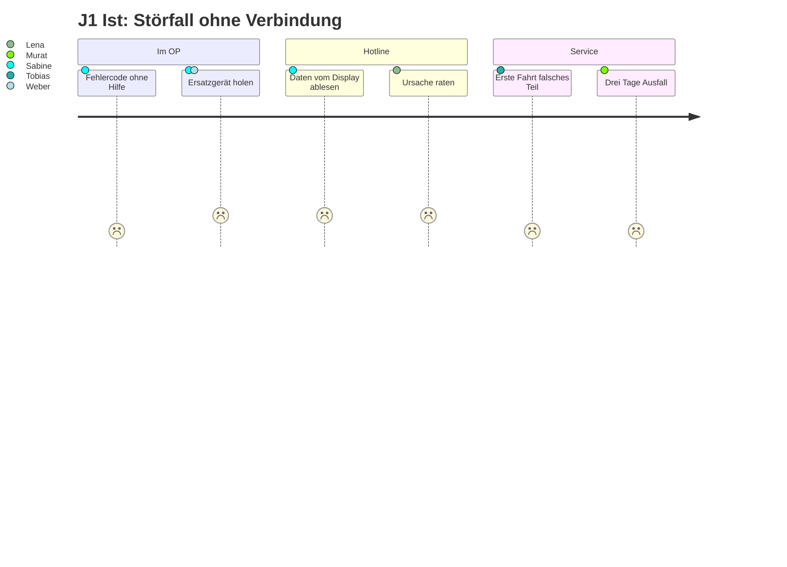
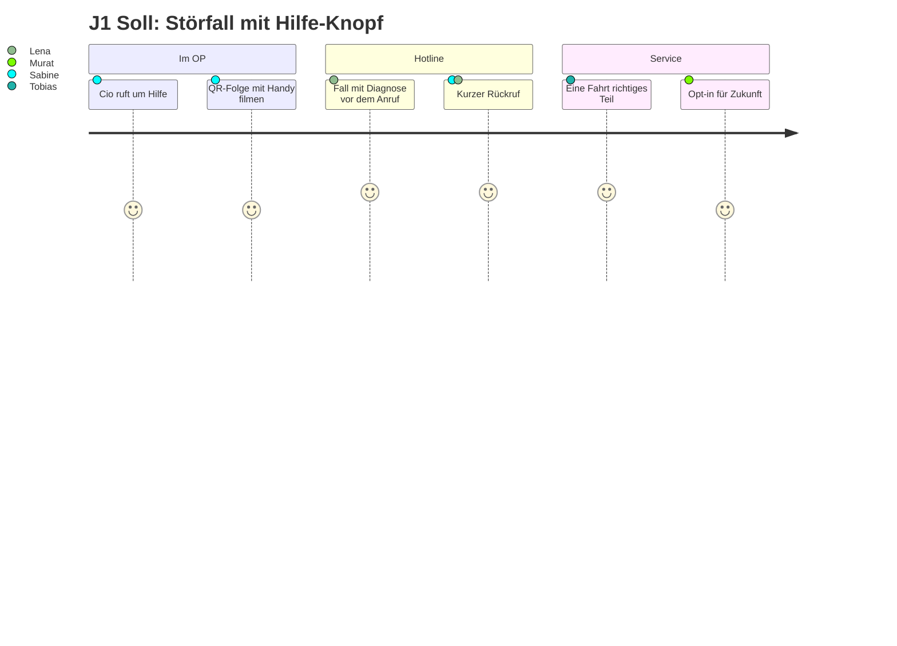
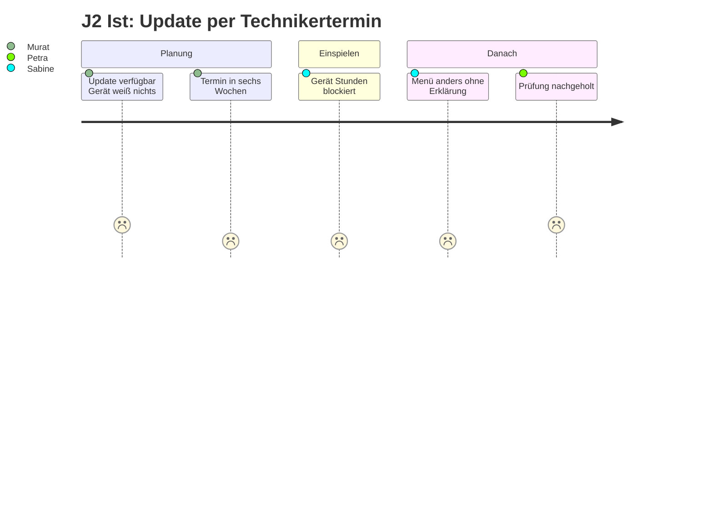
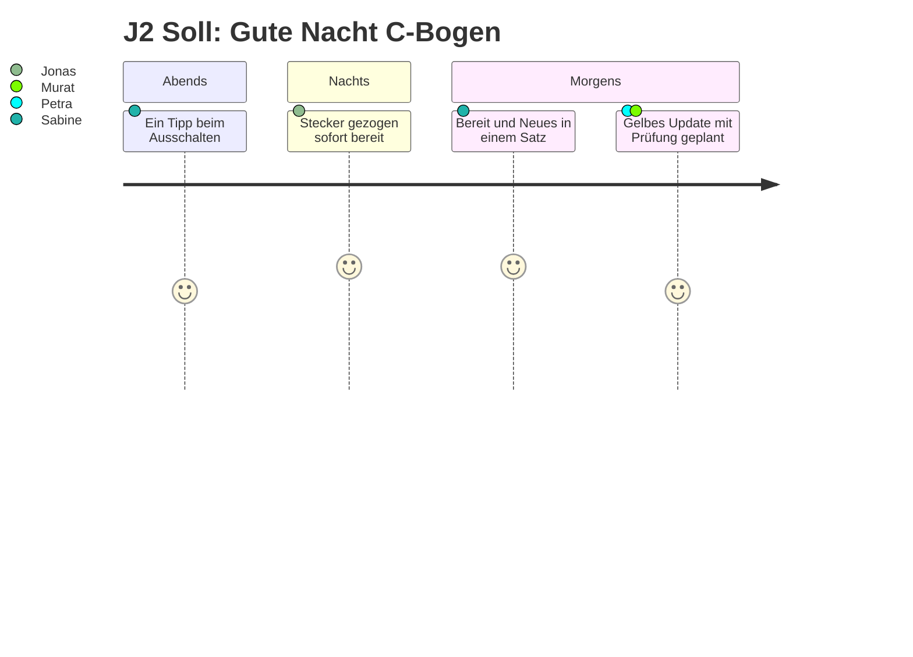
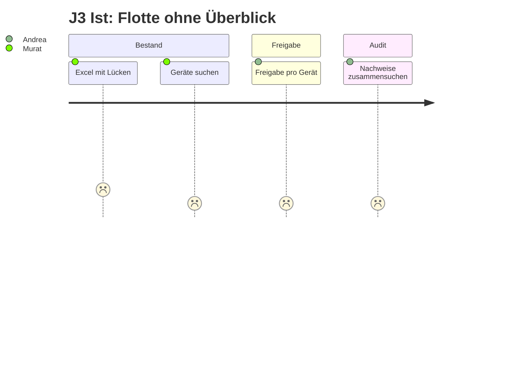
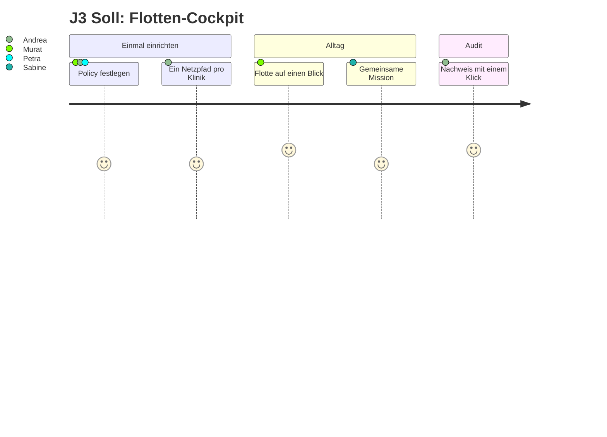

# Challenge 4 – User Journeys

Stand 11.11.2026. Personen sind fiktiv, siehe [personas.md](personas.md). Die Soll-Abläufe nutzen
den Pitch-Vorschlag aus [ideen-vergleich.md](../ideen-vergleich.md): **Hilfe-Knopf mit QR-Brücke
(Idee 1)** als Eröffnung, **„Gute Nacht, C-Bogen“ mit Update-Ampel (Idee 2)** als zweiter Akt,
**Flotten-Cockpit mit Compliance-Dividende (Idee 4)** als Business Case, die Figur **„Cio“ (Idee 8)**
als Gesicht von 1 und 2 und die **Flotten-Mission (Idee 9)** im Cockpit. Zeiten und Gefühle sind
Annahmen, mit MTR und Mentoren prüfen. Alle Logs in der Demo sind synthetisch.

Skala in den Diagrammen: 1 = sehr schlecht, 5 = sehr gut (Mermaid-`journey`, wird auf GitHub
gerendert).

## Übersicht

| Journey | Auslöser | Wer | Soll mit Idee |
|---|---|---|---|
| J1 | Störfall im OP | Sabine, Lena, Tobias | 1 + 8 |
| J2 | Sicherheitsupdate liegt bereit | Sabine, Jonas, Petra | 2 + 8 |
| J3 | Flotte aktuell halten und nachweisen | Murat, Andrea | 4 + 9 |

---

## J1 – Störfall: „Das Bild bleibt schwarz“

**Ausgangslage.** Dienstag, 10:15, Saal 3, Wirbelsäulen-OP. Nach dem Umsetzen zeigt C-Bogen 2 nach
der Auslösung kein Bild. Das Gerät war nie mit dem Remote Service verbunden.

### J1 Ist-Zustand

| # | Phase | Wer | Was passiert | Gefühl | Schmerzpunkt |
|---|---|---|---|---|---|
| 1 | Störung | Sabine (P1) | Fehlermeldung mit Code, keine Handlungsanweisung | Stress, Saal wartet | Meldung ohne Hilfe |
| 2 | Notlösung | Sabine, Dr. Weber (P3) | Holt C-Bogen 3 aus Saal 6, 12 Minuten Verzögerung | Ärger | Ersatzgerät fehlt anderswo |
| 3 | Hotline | Sabine → Lena (P7) | Ruft an, nennt Seriennummer, liest Fehlercode und Softwarestand vom Display ab, 15 Minuten | genervt | Lena hat keine Logs, nur Beschreibungen |
| 4 | Diagnose | Lena | Tippt auf drei Ursachen (Detektor, Kabel, Software) | unsicher | Keine Remote-Vorabklärung (Hauptschmerz laut Interview) |
| 5 | Einsatz | Tobias (P8) | Kommt am nächsten Tag mit zwei Ersatzteilen, Gerät ist im OP, wartet 2 Stunden | frustriert | Zweite Fahrt, weil das richtige Teil fehlt |
| 6 | Folge | Murat (P4) | Gerät 3 Tage außer Betrieb, Ausfall wird in Excel notiert | | Downtime, Servicekosten |

### J1 Soll-Zustand mit Hilfe-Knopf, QR-Brücke und „Cio“

| # | Phase | Wer | Was passiert | Idee |
|---|---|---|---|---|
| 1 | Störung | Sabine | Die Figur „Cio“ zeigt: „Mir geht's nicht gut. Tippe hier, ich schicke dem Service alles.“ | 8, 1 |
| 2 | Diagnosepaket | Gerät | Schnürt ein Paket aus Allowlist-Feldern (Fehlercodes, Softwarestand, Gerätezustand, letzte Ereignisse), keine Patientendaten, signiert | 1 |
| 3 | Kein Netz im OP | Sabine | Display zeigt eine kurze QR-Folge, Sabine filmt sie mit dem Diensthandy (5 Sekunden) | 1 |
| 4 | Fall angelegt | Lena | Sieht den Fall mit Diagnose im Dashboard, bevor Sabine anruft: „Detektor-Kommunikation, Kabel X wahrscheinlich“ | 1 |
| 5 | Rückruf | Lena → Sabine | 3 Minuten, gibt einen Neustart-Tipp, der nicht hilft, und bestellt das Teil | 1 |
| 6 | Einsatz | Tobias | Kommt mit dem richtigen Kabel, Termin im OP-Plan-Fenster, 40 Minuten | 1 |
| 7 | Opt-in | Sabine, Murat | Gerät fragt einmalig: „Soll ich künftig automatisch Diagnosen senden, wenn ich Netz habe?“ Murat bestätigt im Cockpit | 1, 4 |

**Moment of Truth.** Der Moment, in dem jemand freiwillig verbindet, ist der Störfall: „Wer meldet,
bekommt schneller Hilfe.“

---

## J2 – Update: Ein Sicherheitsupdate liegt bereit

**Ausgangslage.** Ein Sicherheitsupdate (Betriebssystem, keine Bildkette, Ampel **grün**) und ein
Update für die Bildverarbeitung (Ampel **gelb**) sind seit drei Wochen verfügbar. C-Bogen 1 ist
manchmal im Netz, wenn er Bilder ans PACS schickt.

### J2 Ist-Zustand

| # | Phase | Wer | Was passiert | Schmerzpunkt |
|---|---|---|---|---|
| 1 | Verfügbar | Hersteller | Update wird angekündigt, Gerät erfährt nichts | Kein Kanal |
| 2 | Termin | Murat (P4), OP-Koordination | Murat sucht ein Zeitfenster, OP-Plan ist voll, Termin in 6 Wochen | Gerät 2 bis 4 Stunden blockiert |
| 3 | Vor Ort | Tobias (P8) | Spielt das Update ein, Gerät dafür aus dem Betrieb | Teure Technikerzeit |
| 4 | Überraschung | Sabine (P1) | Nächster Morgen: Ein Menü sieht anders aus, niemand hat es erklärt | Vertrauensverlust, Einweisungspflicht verletzt |
| 5 | Nachts | Jonas (P2) | (Variante) Ein Update startet beim Einschalten, Notfall wartet | Horrorszenario, das Updates verbrennt |
| 6 | Prüfung | Petra (P6) | Erfährt vom gelben Update erst hinterher, Konstanzprüfung wird nachgeholt | Strahlenschutz-Lücke |

### J2 Soll-Zustand mit „Gute Nacht, C-Bogen“, Update-Ampel und „Cio“

| # | Phase | Wer | Was passiert | Idee |
|---|---|---|---|---|
| 1 | Vorladen | Gerät | Lädt beide Updates gedrosselt, wann immer es im Netz ist (z. B. beim DICOM-Versand), legt sie in den inaktiven Speicherbereich (A/B) | 2 |
| 2 | Ampel | Gerät, Policy | Grün darf laut Klinik-Policy über Nacht laufen. Gelb wird an Murat und Petra gemeldet, nicht an Sabine | 2, 4 |
| 3 | Ausschalten | Sabine, 16:45 | Drückt „Aus“. Cio: „Sicherheitsupdate bereit. Heute Nacht installieren? 12 Minuten, morgen früh bin ich bereit.“ Ein Tipp auf „Ja“ | 2, 8 |
| 4 | Installation | Gerät | Wartet, bis es am Strom und 30 Minuten unbewegt ist, installiert, Selbsttest ohne Strahlung, aus | 2 |
| 5 | Notfall | Jonas, 23:10 | Zieht den Stecker mitten in der Installation. Gerät startet sofort in der alten Version: „Bereit.“ Update wird für die nächste Nacht neu geplant | 2 |
| 6 | Morgen | Sabine, 06:40 | Eine Zeile: „Bereit. Über Nacht aktualisiert. Neu: gespeicherte Positionen.“ Cio ist „fit“. 60-Sekunden-Hinweis „Was ist neu“, überspringbar, Bestätigung dokumentiert | 2, 8 |
| 7 | Gelbes Update | Petra, Murat | Wird mit Konstanzprüfung im OP-Plan-Fenster eingeplant, nicht unsichtbar | 2, 4 |

**Moment of Truth.** Der Notfall um 23:10. Wenn das Gerät hier sofort bereit ist, vertraut das Team
allen weiteren Updates. Das ist der Höhepunkt der Demo (Recherche 01, Design-Implikation 10).

---

## J3 – Flotte: Murat und Andrea vor dem NIS2-Audit

**Ausgangslage.** Der Klinikverbund hat 6 mobile C-Bögen pro Standort. Die interne Revision fragt nach
dem Patch-Stand aller Medizingeräte und nach einem Nachweis für eingespielte Sicherheitsupdates.

### J3 Ist-Zustand

| # | Phase | Wer | Was passiert | Schmerzpunkt |
|---|---|---|---|---|
| 1 | Bestandsliste | Murat (P4) | Excel, Softwarestand bei 12 von 40 Geräten sicher bekannt | Blindflug |
| 2 | Geräte suchen | Murat | Läuft durch drei OP-Trakte, findet ein Gerät im Lager ohne Strom | Allmende-Problem |
| 3 | Freigabe | Andrea (P5) | Hersteller fragt nach Netzfreigabe pro Gerät, MDS2 passt nicht | Einzelfreigaben skalieren nicht |
| 4 | Audit | Andrea | Nachweis aus E-Mails und Serviceberichten zusammengesucht | Tage Arbeit |

### J3 Soll-Zustand mit Flotten-Cockpit und Flotten-Mission

| # | Phase | Wer | Was passiert | Idee |
|---|---|---|---|---|
| 1 | Einmalige Policy | Murat, Andrea, Petra | Legen fest: grüne Updates automatisch nachts, gelbe mit Prüfung, rote nie automatisch, nie alle Geräte eines Hauses in derselben Nacht | 4 |
| 2 | Ein Pfad pro Klinik | Andrea | Gibt Medizingeräte-VLAN an den Parkpositionen frei, nur ausgehend, signierte Pakete, Logs per Allowlist | 4 |
| 3 | Cockpit | Murat | Sieht alle Geräte: Ampel, letzter Kontakt, wartende Updates, offener Störfall, zuletzt gesehen in Saal 5 | 4 |
| 4 | Mission | OP-Teams | Gemeinsames Ziel „Alle C-Bögen diese Woche verbunden“, Fortschrittsbalken im Aufenthaltsraum. Belohnung: neue Funktion freigeschaltet, kein Ranking einzelner Personen | 9 |
| 5 | Audit | Andrea | Ein Klick: Patch-Stand der Flotte, SBOM, Nachweis eingespielter Sicherheitsupdates, Audit-Trail | 4 |

**Moment of Truth.** Der Audit. Wenn Andrea den Nachweis geschenkt bekommt, wird die Gatekeeperin
zur Fürsprecherin.

---

## Was wir aus den Journeys für die Demo ableiten

1. **J1 eröffnet** („erst Hilfe“): Jury-Handy filmt die QR-Folge, Fall erscheint im Dashboard.
2. **J2 ist der Höhepunkt** („dann Updates“): Stecker ziehen mitten im Update, Gerät sofort bereit.
3. **J3 ist der Business Case** („und alle gewinnen“): Cockpit und Audit-Nachweis in 30 Sekunden.
4. Die Figur „Cio“ verbindet J1 und J2 und muss vorher von echten MTR getestet werden („zu verspielt?“).
5. Im UI sichtbar: Demonstrator, kein Medizinprodukt, synthetische Logs.
