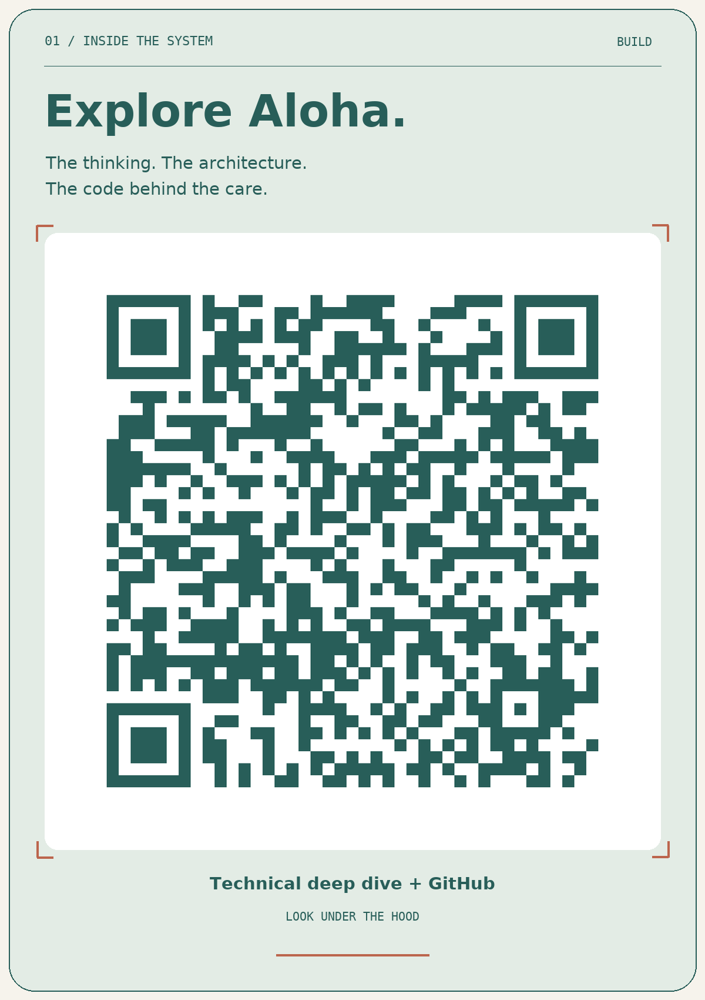
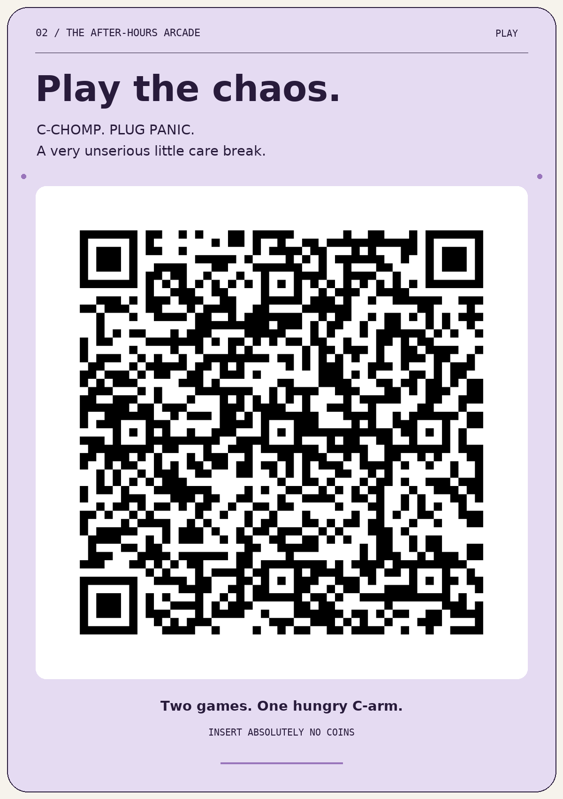
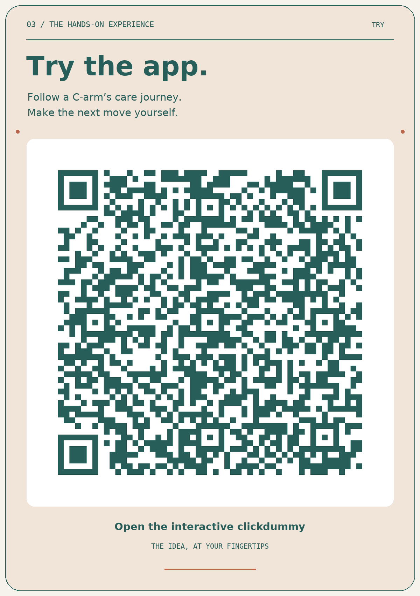

# Aloha Robotics

### Let care keep moving.

Mobile C-arms deserve a little care of their own. Aloha brings together a character people understand, a planner that finds an opportunity for maintenance, and a clear handover to someone who can help. **The system gets attention. The clinical team gets back to the patient.**

**[Visit the Aloha Robotics website ↗](https://clschulzer.github.io/Aloha-Robotics-HH2.0/)**

**4th place · Healthcare Hackathon Bavaria · Erlangen 2026.** Built for Siemens Healthineers Challenge 04: *Invisible Connectivity*. Next: a longer internal Siemens Healthineers discussion in the coming weeks.

## Explore Aloha

| Start here | What you’ll find |
| --- | --- |
| **[Visit the website ↗](https://clschulzer.github.io/Aloha-Robotics-HH2.0/)** | Start with the idea, interactive care loop, technical explanations and source code. |
| **[Watch the hackathon presentation ↗](https://clschulzer.github.io/Aloha-Robotics-HH2.0/Presentation/hackathon/?s=1)** | The final three-minute presentation the team used, including its final QR and layout refinements. |
| **[Play C-Arcade ↗](https://clschulzer.github.io/Aloha-Robotics-HH2.0/C-Arcade/)** | C-CHOMP and PLUG PANIC. One very hungry C-arm; one very busy KettyBot. |
| **[Try Care Companion ↗](https://clschulzer.github.io/Aloha-Robotics-HH2.0/Care-Companion/)** | The phone experience and the detailed platform prototype, ready to explore. |

**[Prepare the Siemens follow-up](Documentation/siemens-follow-up.md)** · **[Read the documentation](Documentation/README.md)** · **[Download the QR kit](https://clschulzer.github.io/Aloha-Robotics-HH2.0/Website/share/)**

## Next: the Siemens conversation

The [preparation brief](Documentation/siemens-follow-up.md) collects the recommended reading, a proposed meeting structure, six questions to resolve and a first validation step. The [four interview transcripts](Documentation/README.md#interview-transcripts), Christian’s post-interview synthesis and the engineering specifications remain easy to find. Meeting details and pilot commitments are still open.

## Take a little Aloha with you

| Explore the system | Play the chaos | Try the platform |
| :---: | :---: | :---: |
| <a href="https://clschulzer.github.io/Aloha-Robotics-HH2.0/ALOHA/"></a> | <a href="https://clschulzer.github.io/Aloha-Robotics-HH2.0/CARMAGOTCHI_APP/arcade/"></a> | <a href="https://clschulzer.github.io/Aloha-Robotics-HH2.0/CARMAGOTCHI_Web_Pitch/klickdummy-christian/"></a> |
| [PNG](Website/share/explore-qr.png) · [SVG](Website/share/explore-qr.svg) | [PNG](Website/share/play-qr.png) · [SVG](Website/share/play-qr.svg) | [PNG](Website/share/app-qr.png) · [SVG](Website/share/app-qr.svg) |

[Download the full three-card sheet](Website/share/three-qr-cards.png) · [Vector sheet for slides or print](Website/share/three-qr-cards.svg)

The codes retain their original public destinations. Existing QR links and installed companion apps continue to work through the preserved legacy routes.

## What we built

The project combines a cinematic web pitch, an interactive service-planning prototype, a mobile companion and two original games. The planning prototype uses explicit JavaScript rules for maintenance windows and human approval; its rules can be run and tested separately from the interface.

**HTML · CSS · JavaScript · Canvas · WebGL · Node’s test runner.** The public experiences run without a build step. Schedules, notifications, robot checks and device updates are demonstrations using invented data; live hospital and manufacturer integrations remain proposed work.

[Explore the technical guide ↗](https://clschulzer.github.io/Aloha-Robotics-HH2.0/Website/technical.html) for the implementation, architecture, source evidence and next steps.

## Find your way around

| Folder | Purpose |
| --- | --- |
| [Presentation/](Presentation/README.md) | The presentation used at the hackathon, its controls and rehearsal guidance. |
| [Website/](Website/README.md) | Public project website, technical guide and downloadable QR assets. |
| [Care-Companion/](Care-Companion/README.md) | Companion experiences and their source code. |
| [C-Arcade/](C-Arcade/README.md) | Both games, controls and implementation notes. |
| [Documentation/](Documentation/README.md) | Research, transcripts, architecture options, specifications and evidence. |
| [Archive/](Archive/README.md) | Earlier presentations, experiments and preserved development history. |

## Run locally

From the repository root:

```bash
python3 -m http.server 8000
```

Open [the website](http://localhost:8000/), [Care Companion](http://localhost:8000/Care-Companion/), [C-Arcade](http://localhost:8000/C-Arcade/) or [the hackathon pitch](http://localhost:8000/Presentation/hackathon/?s=1). Each project’s README contains its controls and relevant checks.

## Preservation and credits

The used presentation’s 14 files are preserved byte for byte in `Presentation/hackathon/`. Its old `FINAL/v5/` link still opens it. The legacy `ALOHA/`, `CARMAGOTCHI_APP/` and `CARMAGOTCHI_Web_Pitch/` folders keep already-shared QR codes and installed apps working; use the clearly named folders above for development.

The complete state before this post-event cleanup is saved at **[backup/post-hackathon-2026-11-14](https://github.com/clschulzer/Aloha-Robotics-HH2.0/tree/backup/post-hackathon-2026-11-14)**. The earlier pre-submission backup also remains available. [Rollback and verification](ROLLBACK.md) · [Archive](Archive/README.md).

**Marc, Sid and Chris · Aloha Robotics.** Team-created film, characters, prototypes and presentation code are preserved with their source material. Font licenses and asset provenance remain beside the relevant assets. This repository documents a hackathon concept; it is not a medical device or a Siemens Healthineers product.
